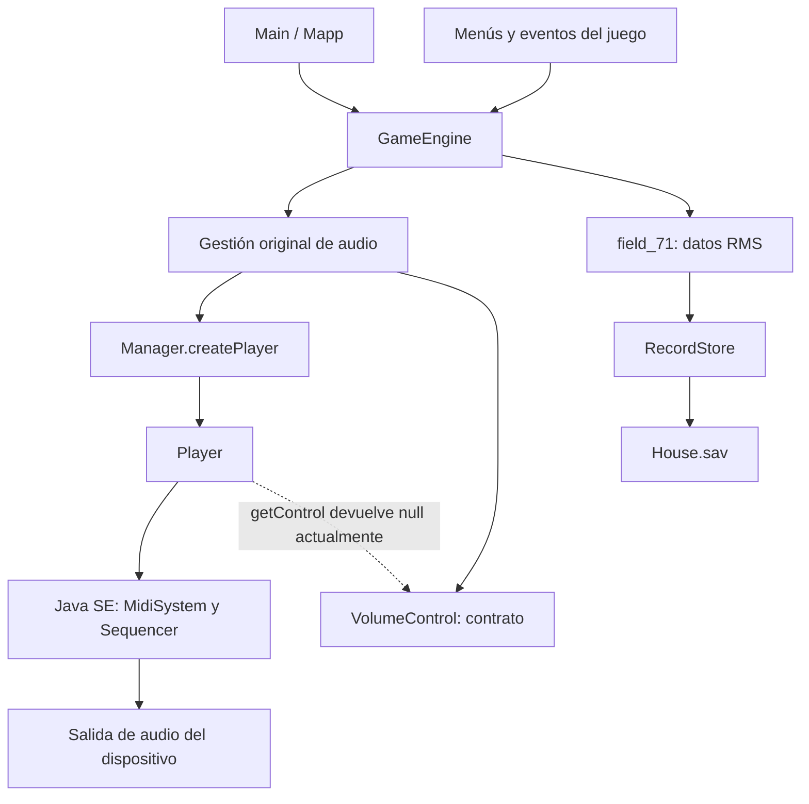
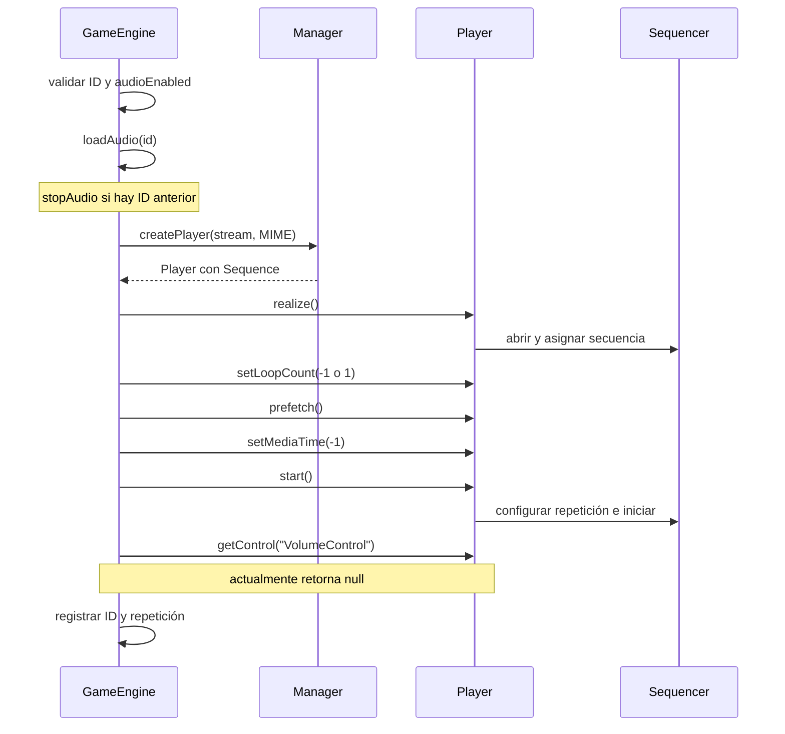
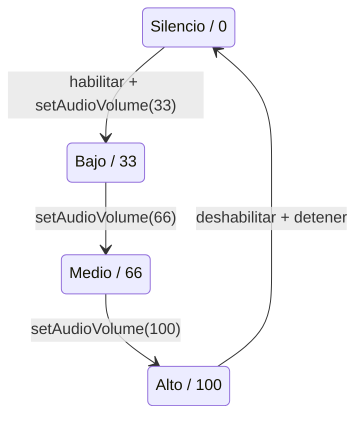
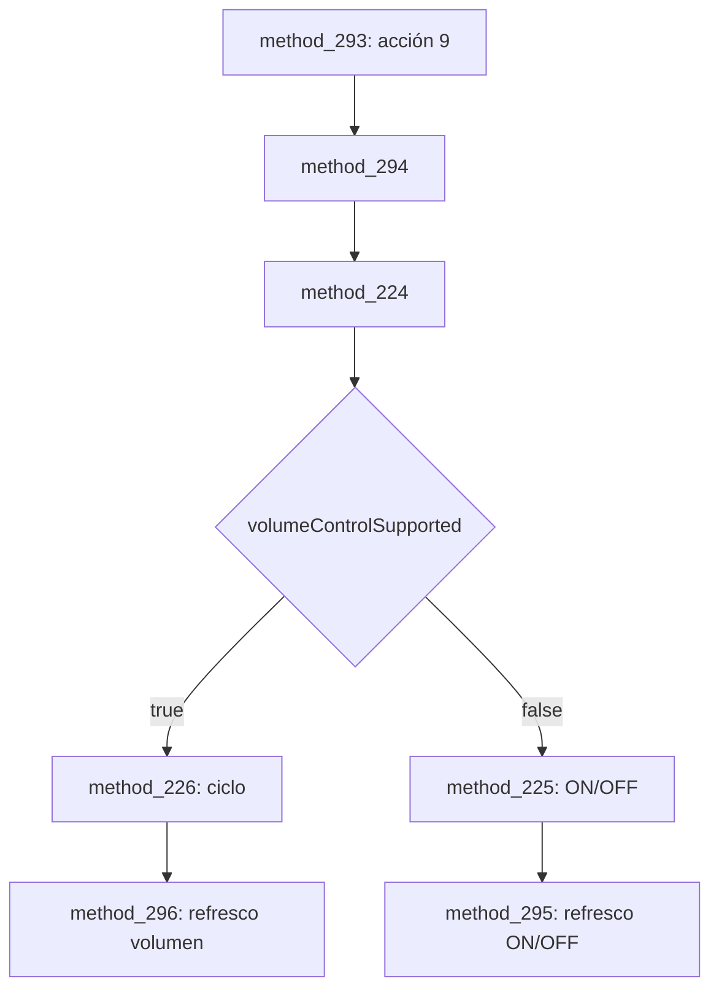

# Sistema de audio — DoctorHousePC

Documentación técnica de ingeniería inversa del sistema de audio de House (2008), adaptado de Java ME a Java SE 17/21 en el proyecto `PortDrHousePCByLoko`.

**Fecha de referencia:** 26 de noviembre de 2026.  
**Versión analizada:** `java(20261126-193846).zip`, posterior a la reversión de los cambios experimentales de volumen y a la primera desofuscación semántica del audio.

## 1. Objetivo y alcance

El objetivo del port es conservar la lógica del videojuego original y sustituir las APIs de Java ME que no existen en Java SE por implementaciones compatibles. El audio original ya incluye reproducción musical, efectos sonoros, activación/desactivación, selección de volumen, persistencia, detección de capacidades y gestión de interrupciones de visibilidad.

Esta documentación distingue tres niveles:

- **Motor original:** lógica recuperada mediante descompilación, actualmente dentro de `GameEngine.java`.
- **Capa de compatibilidad:** implementación del port de `javax.microedition.media` sobre `javax.sound.midi`.
- **Mejoras futuras:** funcionalidades todavía no implementadas en la versión analizada.

La intención de los desarrolladores originales se reconstruye a partir del comportamiento observable en el código; no se dispone de su documentación interna ni de sus nombres originales sin ofuscar. Los nombres semánticos son decisiones del proyecto de portabilidad.

## 2. Arquitectura y distribución de archivos

```text
PortDrHousePCByLoko/
├── Docs/
│   ├── audioSystemGame.md
│   └── savethegame.md
└── src/
    └── src/main/
        ├── java/
        │   ├── Main.java
        │   ├── Mapp.java
        │   ├── GameEngine.java
        │   ├── configuration/GameConfiguration.java
        │   └── javax/microedition/
        │       ├── lcdui/Display.java
        │       ├── lcdui/game/GameCanvas.java
        │       ├── media/
        │       │   ├── Manager.java
        │       │   ├── Player.java
        │       │   └── control/VolumeControl.java
        │       └── rms/RecordStore.java
        └── resources/
            ├── s0.bin
            ├── s1.bin
            ├── s2.bin
            ├── s3.bin
            └── s4.bin
```

Las rutas corresponden a la estructura del repositorio. El ZIP de fuentes analizado contiene el subdirectorio `java/`; los recursos se verificaron por separado en `DoctorHousePC_0.1.0.zip`.



| Componente | Responsabilidad |
|---|---|
| `Main` / `Mapp` | Arranque y ciclo de vida de la aplicación. |
| `GameEngine` | Decide qué reproducir, cuándo detenerlo, cómo configurar el sonido y qué mostrar en los menús. |
| `Manager` | Convierte el flujo de bytes del recurso en una secuencia MIDI y construye un `Player`. |
| `Player` | Adaptador del reproductor Java ME sobre un `Sequencer` de Java SE. |
| `VolumeControl` | Contrato para aplicar un nivel de volumen; todavía no tiene implementación efectiva en el reproductor actual. |
| `RecordStore` | Compatibilidad RMS mediante un archivo binario local. |
| `Display` / `GameCanvas` | Ventana, eventos de teclado y entrada; no gestionan directamente la música. |
| `GameConfiguration` | Configuración de resolución e idioma. En esta versión no contiene parámetros de audio ni `VOLUME_STEP`. |

El motor conserva un solo reproductor estático. No existe un mezclador de música y efectos ni dos canales de reproducción independientes a nivel del motor.

## 3. Catálogo de recursos

```java
private static final String[] audioResourcePaths = new String[]{
    "/s0.bin", "/s1.bin", "/s2.bin", "/s3.bin", "/s4.bin"
};
private static final String[] audioMimeTypes = new String[]{
    "audio/midi", "audio/midi", "audio/midi", "audio/midi", "audio/midi"
};
```

La extensión `.bin` no representa el formato interno. Los cinco archivos del paquete de recursos consultado comienzan con `MThd`, cabecera de Standard MIDI File. No son MP3 ni WAV.

| ID | Recurso | Tamaño (bytes) | Formato MIDI / pistas | Uso identificado en código |
|---:|---|---:|---|---|
| 0 | `s0.bin` | 4451 | 0 / 1 | Música de inicio y menú; repetitiva. |
| 1 | `s1.bin` | 6727 | 0 / 1 | Música de partida y retorno de minijuegos; repetitiva. |
| 2 | `s2.bin` | 4347 | 0 / 1 | Música alternativa solicitada por script; repetitiva. |
| 3 | `s3.bin` | 184 | 1 / 2 | Respuesta correcta en el minijuego de secuencia; también se usa para probar soporte de volumen. |
| 4 | `s4.bin` | 184 | 1 / 2 | Respuesta incorrecta en el mismo minijuego. |

Los usos se derivan de las llamadas a `playAudio`, no de una escucha de las pistas. Todos los archivos examinados tienen división MIDI de 960 ticks por negra (`0x03C0`).

Los IDs son índices de ambos arrays; deben mantenerse alineados. La ruta inicial `/` indica búsqueda desde la raíz del classpath mediante `GameEngine.class.getResourceAsStream(...)`.

## 4. Atributos del motor y desofuscación completada

Los nueve atributos siguientes están agrupados en la sección `//Audio` de `GameEngine.java` (líneas 92–100 de la versión de referencia).

| Nombre ofuscado | Nombre actual | Tipo | Semántica / inicialización |
|---|---|---|---|
| `field_63` | `audioResourcePaths` | `String[]`, static final | Catálogo de rutas. |
| `field_64` | `audioMimeTypes` | `String[]`, static final | Tipo MIME por ID. |
| `field_65` | `audioEnabled` | `boolean` | Permite o impide reproducir; inicialmente false por defecto de Java. |
| `field_66` | `audioVolume` | `int` | Volumen de ejecución 0–100; inicialmente 0 por defecto. |
| `field_67` | `currentAudioId` | `int` | ID registrado como actual; `initializeAudio()` lo fija en -1. |
| `field_68` | `audioLoopEnabled` | `boolean` | Modo repetitivo de la última reproducción registrada. |
| `field_69` | `audioPlayer` | `Player` | Reproductor compartido; inicialmente null. |
| `field_229` | `volumeControlSupported` | `boolean` | Resultado de la prueba de capacidad durante el arranque. |
| `field_230` | `audioIdToResume` | `int` | ID de música repetitiva que se debe reiniciar al recuperar visibilidad; inicialmente -1. |

Todos son `private static`. `audioEnabled` representa permiso de reproducción, no la certeza de que hay sonido audible. `currentAudioId` tampoco consulta si el secuenciador sigue ejecutándose: el motor no registra un callback de fin de pista. `audioLoopEnabled` solo tiene sentido junto con un ID válido.

## 5. Métodos de reproducción desofuscados

Sección de `GameEngine.java`, líneas 2118–2246.

| Original | Actual | Responsabilidad |
|---|---|---|
| `method_68` | `loadAudio(int)` | Detiene el audio anterior registrado y crea otro reproductor a partir del recurso. |
| `method_69` | `playAudio(int, boolean)` | Valida ID y permiso; prepara, inicia y configura la reproducción. |
| `method_70` | `stopAudio()` | Cierra el reproductor si hay ID registrado y establece -1. |
| `method_71` | `closeAudioPlayer(Player)` | Llama a `close()` si la referencia no es null. |
| `method_72` | `getCurrentAudioId()` | Devuelve el ID registrado. |
| `method_73` | `isCurrentAudioLooping()` | Devuelve false si no hay ID válido; en otro caso, el flag de repetición. |
| `method_74` | `supportsVolumeControl(int)` | Crea y realiza un reproductor de prueba, consulta el control y lo cierra. |
| `method_75` | `setAudioVolume(int)` | Limita el valor a 0–100 y lo aplica al control si está disponible. |
| `method_76` | `isAudioEnabled()` | Consulta el permiso de audio. |
| `method_77` | `setAudioEnabled(boolean)` | Cambia el permiso; al deshabilitar detiene el audio registrado. |
| `method_78` | `initializeAudio()` | Inicializa el ID actual en -1. |
| `method_79` | `shutdownAudio()` | Delega en `stopAudio()`. |

Los métodos `loadAudio`, `closeAudioPlayer`, `initializeAudio` y `shutdownAudio` son privados; los demás son públicos. Todos son estáticos. Los parámetros todavía se llaman `var0`, `var1`, etc. en el fuente actual.

### 5.1. Carga y reproducción

`playAudio(int var0, boolean var1)` recibe el ID y el indicador de repetición. Si el ID es inválido o el sonido está deshabilitado no hace nada.



`realize`, `setLoopCount`, `setMediaTime` y la aplicación de volumen capturan excepciones sin propagarlas. Si falla `prefetch` o `start`, se cierra el reproductor y se retorna sin registrar el nuevo ID. La llamada final a `System.currentTimeMillis()` no utiliza su resultado.

### 5.2. Control de volumen en memoria

Código actual (formato ajustado para lectura):

```java
public static void setAudioVolume(int var0) {
    try {
        audioVolume = Math.max(0, Math.min(var0, 100));
        VolumeControl var1;
        if (currentAudioId >= 0 &&
            (var1 = (VolumeControl) audioPlayer.getControl("VolumeControl")) != null) {
            var1.setLevel(audioVolume);
        }
    } catch (Exception var2) {
    }
}
```

Este método no modifica `field_71[3]`, no activa el sonido, no inicia música y no actualiza el menú. Su responsabilidad es mantener el volumen de ejecución y solicitar su aplicación al reproductor. Al reproducir una nueva pista, `playAudio` vuelve a intentar aplicar ese valor.

### 5.3. Detención y ciclo de vida

`stopAudio()` cierra el reproductor si `currentAudioId >= 0`, y luego pone el ID en -1. No pone `audioPlayer` a null ni reinicia `audioLoopEnabled`. El getter de repetición protege este último estado consultando el ID.

`setAudioEnabled(false)` llama a `stopAudio` si hay un ID actual. `setAudioEnabled(true)` solamente habilita la reproducción; la elección de la pista corresponde a los métodos superiores.

## 6. Detección de soporte de volumen

Durante `method_230()` (línea 5202):

```java
volumeControlSupported = supportsVolumeControl(3);
```

El método comprueba el rango del ID, carga el recurso 3, realiza el reproductor, consulta `getControl("VolumeControl")`, lo cierra y devuelve true únicamente si obtuvo un control no nulo. En caso de excepción devuelve false (salvo que el propio cierre produzca una excepción no gestionada).

No reproduce deliberadamente el efecto durante la prueba. No comprueba que el control modifique realmente la amplitud audible: solo verifica disponibilidad de la interfaz. Además, `loadAudio` puede detener una pista anterior, por lo que esta prueba se ejecuta al inicializar el motor y no debe considerarse una consulta sin efectos secundarios.

La capacidad detectada determina si los menús muestran cuatro niveles o un interruptor de sonido.

## 7. Configuración original del sonido

Los siguientes métodos todavía conservan sus nombres ofuscados. Los nombres propuestos no se han aplicado.

| Método | Nombre candidato | Función |
|---|---|---|
| `method_223(boolean)` | `handleAudioVisibilityChange` | Detiene o reinicia música al cambiar la visibilidad. |
| `method_224()` | `changeAudioSetting` | Selecciona el mecanismo de configuración según la capacidad. |
| `method_225()` | `toggleAudio` | Alterna sonido habilitado/deshabilitado. |
| `method_226()` | `cycleAudioVolume` | Recorre los niveles de volumen originales. |
| `method_227(int)` | `handleVisibilityStateChange` | Gestiona el estado general del motor y delega en el audio. No es exclusivamente de audio. |

### 7.1. Selección del mecanismo

```java
private static void method_224() {
    if (volumeControlSupported) {
        method_226();
    } else {
        method_225();
    }
}
```

### 7.2. Modo compatible sin control de volumen (`method_225`)

Si el sonido está habilitado, llama a `setAudioEnabled(false)` y `stopAudio()`. Si estaba deshabilitado, llama a `setAudioEnabled(true)` y elige música según el estado del juego:

| Condición | Acción al habilitar |
|---|---|
| `field_226 == 5` o `6` | `playAudio(0, true)` |
| `field_226 == 2` y `!field_390` | `playAudio(1, true)` |
| Otro estado | No inicia una pista desde este método. |

Este método **no escribe** `field_71[3]`. En consecuencia, no garantiza que el estado ON/OFF elegido en el menú sin control de volumen quede reflejado en el byte persistente. No confundirlo con el ciclo de volumen.

### 7.3. Modo original con control de volumen (`method_226`)

El sistema admite cuatro niveles exactos:



| Estado anterior | Nuevo `field_71[3]` | Acción |
|---|---:|---|
| Sonido deshabilitado | 33 | Habilita, aplica 33 e inicia la música correspondiente si el estado lo permite. |
| Habilitado, 33 | 66 | Aplica el nuevo nivel. |
| Habilitado, 66 | 100 | Aplica el nuevo nivel. |
| Habilitado, 100 | 0 | Deshabilita y detiene. |
| Habilitado, otro valor | Sin cambio | No entra en ninguna condición. |

El paso de 100 a 0 no invoca `setAudioVolume(0)`; el silencio se consigue cerrando el reproductor. Por eso `audioVolume` puede conservar 100 aunque el byte persistente sea 0. No se debe imponer como invariante que ambos valores sean siempre iguales.

Los valores intermedios (por ejemplo 46) no forman parte del ciclo original. Introducirlos sin adaptar los consumidores rompería el recorrido de niveles.

## 8. Menús originales de audio

### 8.1. Variables relacionadas

| Identificador | Nombre candidato | Responsabilidad |
|---|---|---|
| `field_291` | `audioOnMenuItemId` | Identificador del elemento ON. |
| `field_292` | `audioOffMenuItemId` | Identificador del elemento OFF/silencio. |
| `field_293` | `highVolumeMenuItemId` | Elemento de volumen alto. |
| `field_294` | `mediumVolumeMenuItemId` | Elemento de volumen medio. |
| `field_295` | `lowVolumeMenuItemId` | Elemento de volumen bajo. |
| `field_256` | Pendiente | Array de IDs de elementos visibles del menú; posición 0 usada por la opción de audio. |
| `field_251` | Pendiente | Array de datos asociados al elemento; se asigna `field_262` al elemento activo. |
| `field_262` | Pendiente | Valor usado al refrescar el elemento activo. |
| `field_226` | Pendiente | Estado principal del motor, no exclusivamente de audio. |
| `field_390` | Pendiente | Flag de contexto que impide iniciar música normal en ciertas situaciones; se usa en el flujo de minijuego. |

Los nombres de los cinco IDs de menú son candidatos semánticos; no equivalen a los porcentajes. No se propone renombrar estructuras genéricas sin estudiar todos sus usos.

### 8.2. Construcción y actualización

| Método | Nombre candidato | Responsabilidad |
|---|---|---|
| `method_289(int)` | `buildAudioSettingsMenu` | Elige menú de volumen o ON/OFF. |
| `method_290(int)` | `buildAudioToggleSettingsMenu` | Construye opciones ON/OFF y ajusta el menú principal. |
| `method_291(int)` | `buildVolumeSettingsMenu` | Construye opciones de volumen y ajusta el menú principal. |
| `method_293(...)` | Pendiente | Despachador general de acciones; caso 9 ejecuta `method_294`. |
| `method_294()` | `changeAudioMenuSetting` | Ejecuta `method_224` y refresca el menú adecuado. |
| `method_295()` | `refreshAudioToggleMenu` | Refleja el flag habilitado/deshabilitado. |
| `method_296()` | `refreshVolumeMenu` | Refleja el nivel guardado y el flag habilitado. |
| `method_334()` | `buildInGameAudioMenu` | Elige modalidad del menú dentro de la partida. |
| `method_335()` | `buildInGameAudioToggleMenu` | Configuración ON/OFF durante partida. |
| `method_336()` | `buildInGameVolumeMenu` | Configuración de volumen durante partida. |
| `method_337(int,int,int,int,int,int,boolean)` | `buildVolumeMenu` | Construye menú reutilizable de cuatro niveles y opciones adicionales. |
| `method_338(int,int,int,int,boolean)` | `buildAudioToggleMenu` | Construye menú reutilizable ON/OFF y opciones adicionales. |



El diagrama resume el flujo: los métodos de refresco son invocados por `method_294` después de retornar de `method_224`, no directamente por los métodos 225/226.

### 8.3. Representación del nivel

`method_296` y `method_337` consultan `isAudioEnabled()` antes de examinar `field_71[3]`:

| Condición | Elemento visible |
|---|---|
| Deshabilitado | `field_292` |
| Habilitado y valor 33 | `field_295` |
| Habilitado y valor 66 | `field_294` |
| Habilitado y cualquier otro valor | `field_293` |

`method_296` asigna el elemento a `field_256[0]`, actualiza su dato asociado en `field_251`, llama a `method_245` para los otros elementos y termina con `method_259`. Los detalles generales de esas operaciones gráficas quedan fuera de la desofuscación confirmada.

`method_337` obtiene los IDs con `method_244`, usa `method_256(..., 9)` para registrar la opción de audio y agrega otras opciones según sus parámetros. `method_338` aplica el mismo patrón para ON/OFF.

## 9. Persistencia: `field_71[3]`

La configuración original comparte el array RMS de 512 bytes (`field_71`) con los datos de partida. El índice 3 contiene el nivel de audio.

```java
// method_230: inicialización de un registro nuevo
if (field_71[0] == -1) {
    field_71[0] = 1;
    field_71[1] = -1;
    field_71[2] = 1;
    field_71[3] = 66;
    field_71[4] = 0;
}
```

El volumen predeterminado de un registro nuevo es 66. El índice 2 también se inicializa, pero no se ha demostrado que participe en el control del sonido de la versión analizada.

| Dato | Responsabilidad |
|---|---|
| `field_71[3]` | Nivel almacenado en el buffer RMS. |
| `audioVolume` | Nivel en memoria destinado al reproductor. |
| `audioEnabled` | Permiso de reproducción en ejecución. |
| `volumeControlSupported` | Capacidad detectada del dispositivo; no es una preferencia guardada. |

### 9.1. Escrituras y lecturas del índice 3

| Método | Operación |
|---|---|
| `method_230` | Inicializa 66 para registro nuevo. |
| `method_235`, caso 2 | Si el usuario acepta sonido, cambia 0 a 66 y aplica el nivel solo si hay soporte; si rechaza, escribe 0. |
| `method_226` | Escribe 33, 66, 100 o 0 durante el ciclo original. |
| `method_296`, `method_337` | Consultan los valores exactos para mostrar el menú. |

En la pantalla inicial se vuelve a preguntar si se desea sonido; elegir afirmativamente con un valor guardado de 0 restablece 66. Por tanto, el byte guardado no equivale a un interruptor ON/OFF restaurado automáticamente en todas las circunstancias.

### 9.2. Archivo físico

- `method_80`: crea el buffer, abre `RecordStore` llamado `House`, lee el registro existente o crea uno nuevo.
- `method_82`: lee el registro 1.
- `method_83`: escribe el buffer completo en el registro 1; devuelve un booleano de éxito.
- `method_81`: intenta guardar y cerrar el almacenamiento; finalmente pone el buffer a null.
- `method_346`: guarda datos de partida y llama a `method_83`.

La capa RMS guarda en `${user.home}/.doctorhousepc/House.sav`, salvo que se especifique la propiedad JVM `house.saveDir`. `RecordStore.setRecord` copia el rango de bytes, crea el directorio si hace falta y escribe mediante `Files.write`.

Los métodos de volumen no escriben directamente el archivo: actualizan el buffer, que se persiste mediante los puntos de guardado existentes. No se garantiza persistencia si el proceso termina abruptamente.

Una posible desofuscación futura, sin alterar el formato, es `private static final int SAVE_AUDIO_VOLUME_INDEX = 3;`. Aún no existe en el código analizado. Véase también `savethegame.md`.

## 10. Ciclo de vida, visibilidad e integración con el juego

### 10.1. Arranque y cierre

El constructor de `GameEngine` llama a `method_80()` para abrir los datos persistentes y a `initializeAudio()` antes de arrancar el hilo del juego. Posteriormente `method_230()` inicializa los datos nuevos y detecta soporte de volumen. `method_235()` procesa la selección de sonido de la pantalla inicial y, si se acepta, reproduce el recurso 0.

Al cerrar la ventana, `Display` llama a `Mapp.requestExit()`, que pone `GameEngine.field_30` a false. Al terminar el bucle, el motor llama a `Mapp.method_409()`, que ejecuta `destroyApp(true)` y `notifyDestroyed()`. `GameEngine.method_17()` llama a `method_81()` y `shutdownAudio()`, cerrando almacenamiento y reproductor.

### 10.2. Interrupciones de visibilidad

El mecanismo original recuperado está formado por `hideNotify()`, `showNotify()`, la cola `field_48`, `method_13()`, `method_14()`, `method_227(int)` y `method_223(boolean)`.

- Al ocultarse, `hideNotify()` encola el valor 1. El hilo del motor lo consume, `method_13()` llama a `method_227(0)` y limpia las teclas retenidas.
- `method_227(0)` guarda el estado del juego en `field_227`, cambia a estado 1 y solicita suspensión mediante `method_223(false)`.
- Si el audio está habilitado y se estaba reproduciendo en bucle un ID válido, se guarda en `audioIdToResume`; de lo contrario se escribe -1. Se detiene el audio.
- Al mostrarse, `showNotify()` encola 2. `method_14()` llama a `method_227(1)`, restaura el estado previo cuando corresponde e invoca `method_223(true)`.
- Si el sonido sigue habilitado y el ID guardado es válido, se llama a `playAudio(audioIdToResume, true)`. La pista se carga nuevamente desde el inicio, no desde la posición exacta anterior.

**Limitación del port actual:** `Display.java` no conecta eventos de minimización/restauración con `hideNotify()` y `showNotify()`. En `GameCanvas.java`, `focusLost()` únicamente libera las teclas. Por tanto, la lógica de suspensión existe en el motor, pero no se ha demostrado que se active mediante los eventos de ventana del escritorio. No debe confundirse perder el foco con el ciclo de visibilidad de Java ME.

### 10.3. Puntos de invocación en el motor

| Método | Audio o acción |
|---|---|
| `method_187`, caso 17 | Selección de pista 1 o 2 a partir de `field_193[0]`. |
| `method_223` | Detener o reiniciar música por visibilidad. |
| `method_225`, `method_226` | Detener/reactivar audio desde configuración. |
| `method_235` | Pista 0 al aceptar sonido al inicio. |
| `method_279` | Detención en dos ramas de transición del menú. |
| `method_301` | Detención en el flujo de carga. |
| `method_303` | Pista 1 en el flujo de entrada a partida. |
| `method_306` | Pista 1 si audio habilitado y el ID actual no es 1, dentro de una rama concreta. |
| `method_342` | Pista 0 al retornar al menú. |
| `method_343` | Detención durante otra transición. |
| `method_394` | Detención al preparar un minijuego. |
| `method_396` | Pista 1 al finalizar el minijuego, cuando se restaura su contexto. |
| `method_397` | Pista 3 si coincide la respuesta con la secuencia esperada; pista 4 en caso contrario. |

Las funciones genéricas de transición aún están ofuscadas; las descripciones de contexto se limitan a las ramas observadas, sin atribuirles una responsabilidad exclusiva de audio.

## 11. Implementación del port Java SE

### 11.1. `Manager.java`

```java
public static Player createPlayer(InputStream in, String type) throws Exception {
    try (in) {
        return new Player(javax.sound.midi.MidiSystem.getSequence(in));
    }
}
```

Lee una secuencia MIDI desde el recurso y cierra el stream mediante try-with-resources. El parámetro `type` mantiene la compatibilidad con las llamadas originales pero no se utiliza para seleccionar un decodificador. No es una implementación multimedia general de Java ME.

### 11.2. `Player.java`

| Atributo | Función |
|---|---|
| `sequence` | `Sequence` final con los datos MIDI decodificados. |
| `sequencer` | `Sequencer` de Java SE, creado al realizar el reproductor. |
| `loops` | Número de reproducciones solicitado, inicialmente 1. |

| Método | Implementación actual |
|---|---|
| `realize()` | Obtiene `MidiSystem.getSequencer()`, abre el secuenciador y asigna la secuencia si todavía no existe. |
| `prefetch()` | Delega en `realize()`. No reproduce ni implementa una fase independiente de precarga. |
| `setLoopCount(int n)` | Almacena el valor solicitado. |
| `setMediaTime(long t)` | Si existe el secuenciador, fija la posición en microsegundos a `Math.max(0, t)`; devuelve ese valor. |
| `start()` | Realiza el reproductor si hace falta, traduce el número de repeticiones e inicia. |
| `close()` | Cierra el secuenciador si existe y lo pone a null. |
| `getControl(String name)` | Devuelve null para cualquier nombre. |

Traducción del número de reproducciones:

```java
sequencer.setLoopCount(
    loops < 0 ? Sequencer.LOOP_CONTINUOUSLY : loops - 1
);
```

Java ME solicita -1 para repetición indefinida y 1 para reproducción única. En Java SE, el contador representa repeticiones adicionales; por ello 1 se traduce a 0. El adaptador trata cualquier valor negativo como repetición indefinida y no valida expresamente cero; el motor utiliza únicamente -1 y 1.

La llamada original `setMediaTime(-1L)` se traduce en posición 0 dentro de este adaptador. No se gestiona un `Synthesizer` explícito: se usa la conexión por defecto de `MidiSystem.getSequencer()`, cuya disponibilidad depende de la instalación y del dispositivo de audio.

### 11.3. `VolumeControl.java`

```java
package javax.microedition.media.control;

public interface VolumeControl {
    int setLevel(int level);
}
```

Es un contrato mínimo compatible con el uso del motor, no la implementación completa de la API MMAPI. No tiene implementación concreta en la versión analizada.

```java
// Player.java
public Object getControl(String name) {
    return null;
}
```

**Consecuencia:** aunque el motor original dispone de un algoritmo de volumen, el port informa que no admite dicho control. `supportsVolumeControl(3)` retorna false y los menús eligen `method_225`, `method_295` y `method_338`. Invocar `setAudioVolume` directamente modifica su atributo, pero no la amplitud del sonido.

No debe solucionarse retornando un objeto ficticio: la implementación deberá modificar realmente el volumen del dispositivo MIDI y mantener la compatibilidad con el contrato.

## 12. Historial del desarrollo y decisiones de arquitectura

1. Se recuperó la lógica de House desde código Java ME descompilado con Vineflower; el motor inicialmente se llamaba `class_3` y posteriormente se renombró a `GameEngine`.
2. Se implementó una capa mínima de compatibilidad para cargar y reproducir los recursos MIDI mediante Java SE, conservando las llamadas originales a `Manager`, `Player` y `VolumeControl`.
3. Se experimentó con F5/F6, máscaras de entrada nuevas, `VOLUME_STEP`, `processPcControls` y una implementación explícita de sintetizador con volumen maestro MIDI.
4. Se descubrió que el motor ya gestionaba sus propios niveles persistentes, menú y reactivación. La solución experimental modificaba el volumen de ejecución sin integrarse completamente con esos estados originales.
5. Se decidió revertir la implementación experimental y estudiar primero el código existente. Los commits identificados fueron `ce21a8b` (WIP: update vol) y `e500b03` (WIP: VOL CONTROL), posteriores a `1622633` (desofuscación de idiomas). El historial remoto no se ha consultado para este documento; la reversión se constata en el contenido de las versiones de fuentes disponibles.
6. En la versión documentada se completó el renombramiento de nueve atributos y doce métodos de audio, agrupando los atributos relacionados. El resto de los métodos de configuración y menú sigue pendiente de desofuscación.

### Estado de las funcionalidades experimentales

| Elemento | Estado en la versión de referencia |
|---|---|
| `KEY_VOLUME_DOWN`, `KEY_VOLUME_UP` | Ausentes. |
| F5/F6 para modificar volumen | No implementado. |
| `processPcControls()` | Ausente. |
| `VOLUME_STEP` | Ausente. |
| `updateGameVolume()` | Ausente. |
| Sintetizador explícito con mensajes Master Volume | No implementado actualmente. |
| Ciclo original 0/33/66/100 | Conservado en el motor; no seleccionado por el adaptador actual. |
| Desofuscación semántica de 21 identificadores | Presente. |

## 13. Limitaciones y riesgos técnicos identificados

Estos puntos se documentan para futuras tareas; no constituyen cambios aprobados ni fallos reproducidos durante ejecución.

| Observación estática | Impacto potencial |
|---|---|
| `getControl()` siempre retorna null. | No existe control de volumen efectivo a través de la API del motor. |
| `loadAudio` captura excepciones y no borra antes la referencia anterior. | Si falla la creación, puede quedar una referencia a un reproductor previamente cerrado. |
| Excepciones de audio ignoradas en el motor. | Fallos de recursos o dispositivo pueden producir silencio sin diagnóstico. |
| `stopAudio` depende de `currentAudioId`. | Una referencia existente no implica necesariamente un reproductor abierto o un ID registrado. |
| No existe callback de fin de pista. | El ID registrado puede mantenerse después de finalizar un efecto de reproducción única. |
| Reproductor único. | Un efecto puede reemplazar música de fondo; no hay mezcla independiente a nivel del motor. |
| `method_225` no escribe el byte de volumen. | La selección ON/OFF no se refleja necesariamente en el almacenamiento. |
| `method_226` solo admite valores exactos. | Un valor intermedio puede dejar sin transición el ciclo del menú. |
| Eventos de visibilidad no conectados en `Display`. | Minimizar o recuperar una ventana puede no reproducir el comportamiento de suspensión del móvil. |
| Volumen aplicado después de iniciar la pista. | Al implementar el control real, conviene verificar que no aparezca un breve inicio a volumen distinto. |

## 14. Plan recomendado de evolución

El orden de trabajo debe respetar el objetivo de conservación del juego original:

1. Completar la desofuscación de los métodos `223–226` y `294–296`, revisando los nombres propuestos, sin cambiar sus algoritmos.
2. Identificar semánticamente los elementos y constructores de menú relacionados con audio, evitando renombrar estructuras genéricas sin investigar todos sus usos.
3. Implementar el contrato `VolumeControl` en la capa de compatibilidad con Java SE. Elegir un mecanismo MIDI que controle efectivamente la amplitud general sin destruir el balance musical de la secuencia.
4. Validar la detección de capacidad y las opciones originales OFF, bajo, medio y alto, sin introducir teclas adicionales.
5. Validar persistencia, reproducción de efectos y reinicio de música. Evaluar por separado la conexión de eventos de visibilidad del escritorio.
6. Solo si se aprueba una mejora de PC, conectar atajos de teclado al sistema existente. Mantener inicialmente los niveles originales o documentar explícitamente cualquier cambio de política y de representación del menú.

No modificar el formato de `House.sav` ni crear una segunda configuración de volumen sin una necesidad demostrada. `setAudioVolume` es una operación de bajo nivel, mientras `method_224`/`method_226` contienen la política original de configuración.

## 15. Plan de pruebas de regresión

| ID | Prueba | Resultado esperado |
|---|---|---|
| A01 | Arranque con recursos MIDI disponibles. | Se detecta la capacidad sin reproducir el recurso 3 como parte de la prueba. |
| A02 | Aceptar sonido al inicio. | Comienza pista 0 en bucle. |
| A03 | Rechazar sonido al inicio. | `audioEnabled == false`, índice 3 igual a 0 y sin reproducción iniciada. |
| A04 | Entrar a configuración con el adaptador actual. | Aparece selector ON/OFF, no niveles de volumen. |
| A05 | Alternar OFF y ON en menú. | Se detiene y reinicia la música según contexto original. |
| A06 | Entrar en partida con sonido habilitado. | Pista 1 cuando el flujo correspondiente la solicita. |
| A07 | Respuesta correcta/incorrecta del minijuego. | Efectos 3/4 respectivamente, sin bucle. |
| A08 | Finalizar minijuego. | Se recupera música de partida mediante el flujo original. |
| A09 | Cerrar normalmente. | Se intenta guardar el registro y cerrar el reproductor. |
| A10 | Tras implementar `VolumeControl`: abrir configuración. | Se selecciona menú de cuatro niveles. |
| A11 | Tras implementar el control: recorrer 33, 66, 100 y 0. | Cambian volumen audible, menú y byte guardado según la lógica original. |
| A12 | Tras implementar el control: guardar nivel no nulo y reiniciar. | Al aceptar sonido al inicio se aplica el nivel guardado. |
| A13 | Tras conectar visibilidad: ocultar y mostrar con música en bucle. | Se detiene y luego reinicia el recurso correspondiente. |
| A14 | Probar Java 17 y 21. | Compilación y comportamiento de audio compatibles en el entorno de escritorio. |

Para una prueba de guardado utilizar una copia del archivo `House.sav` o un directorio separado mediante `-Dhouse.saveDir=...`. Para pruebas auditivas, comprobar el volumen real, no únicamente el valor de una variable o un mensaje de log.

## 16. Referencias de código y alcance de la verificación

| Fuente | Ubicación o contenido |
|---|---|
| `java(20261126-193846).zip` | Fuente principal de esta documentación. |
| `GameEngine.java` | Atributos 92–100; ciclo de vida 912–1044; reproducción 2118–2246; RMS 2250–2295; script 4533–4535; configuración 5011–5110; arranque 5189–5294; menús 6154–6349 y 7045–7120; minijuego 8264–8331. |
| `java(20261126-150207).zip` | Versión anterior a la primera desofuscación del audio. |
| `java(20261126-061008).zip` | Versión experimental anterior a la reversión. |
| `DoctorHousePC_0.1.0.zip` | Cabeceras y tamaños de los cinco recursos MIDI. |
| `savethegame.md` | Documentación complementaria de RMS y archivo de partida. |

Las líneas corresponden al ZIP principal y pueden desplazarse con los próximos renombramientos. El análisis es estático; no se han ejecutado pruebas auditivas ni se ha modificado el código fuente. Los nombres candidatos representan propuestas de desofuscación, no identificadores ya implementados.
