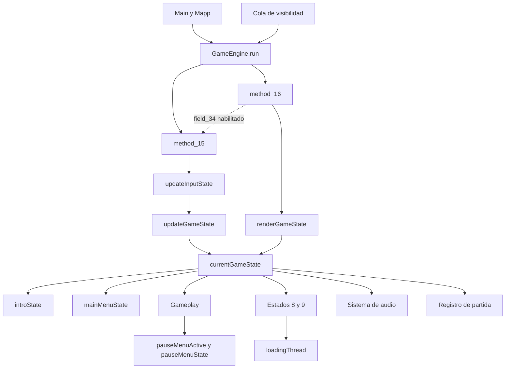
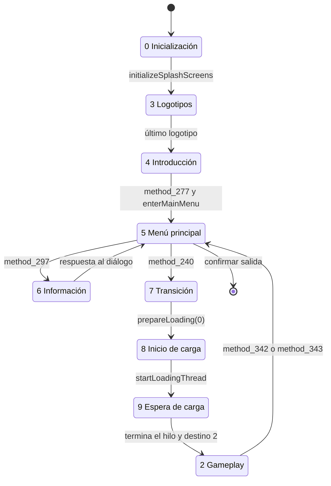
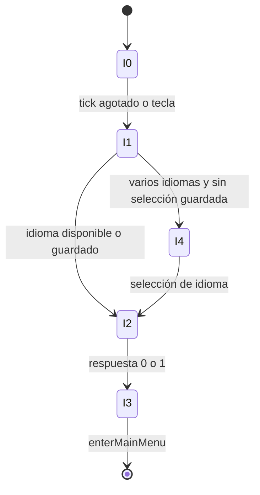
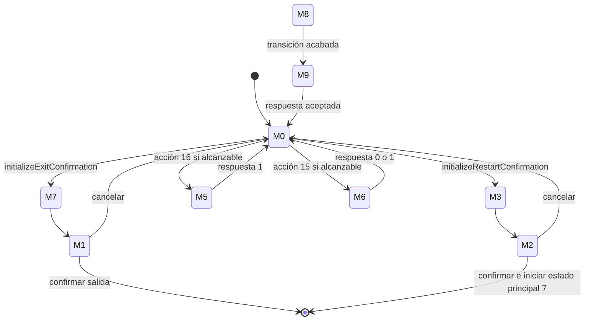
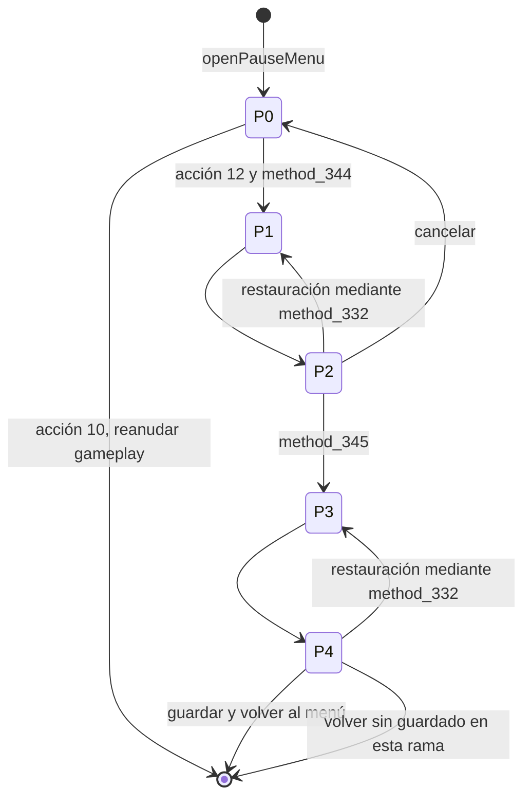
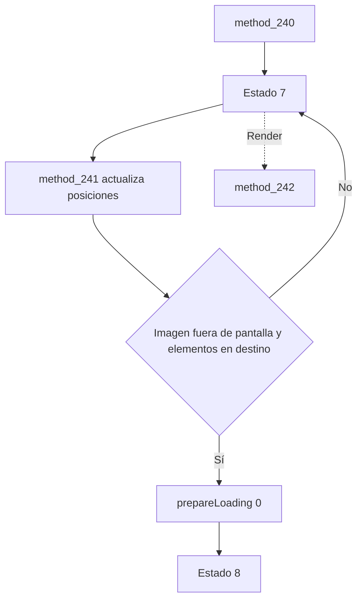
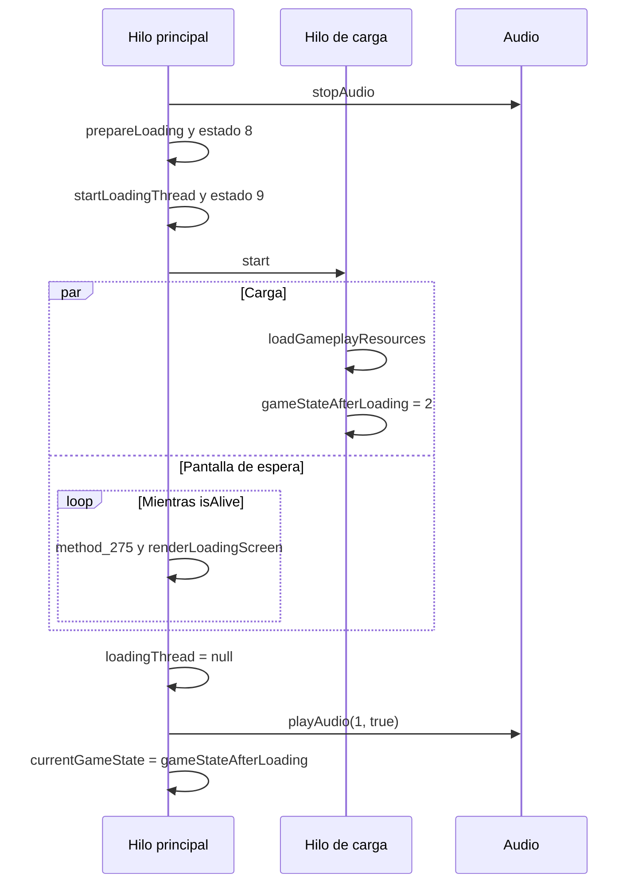
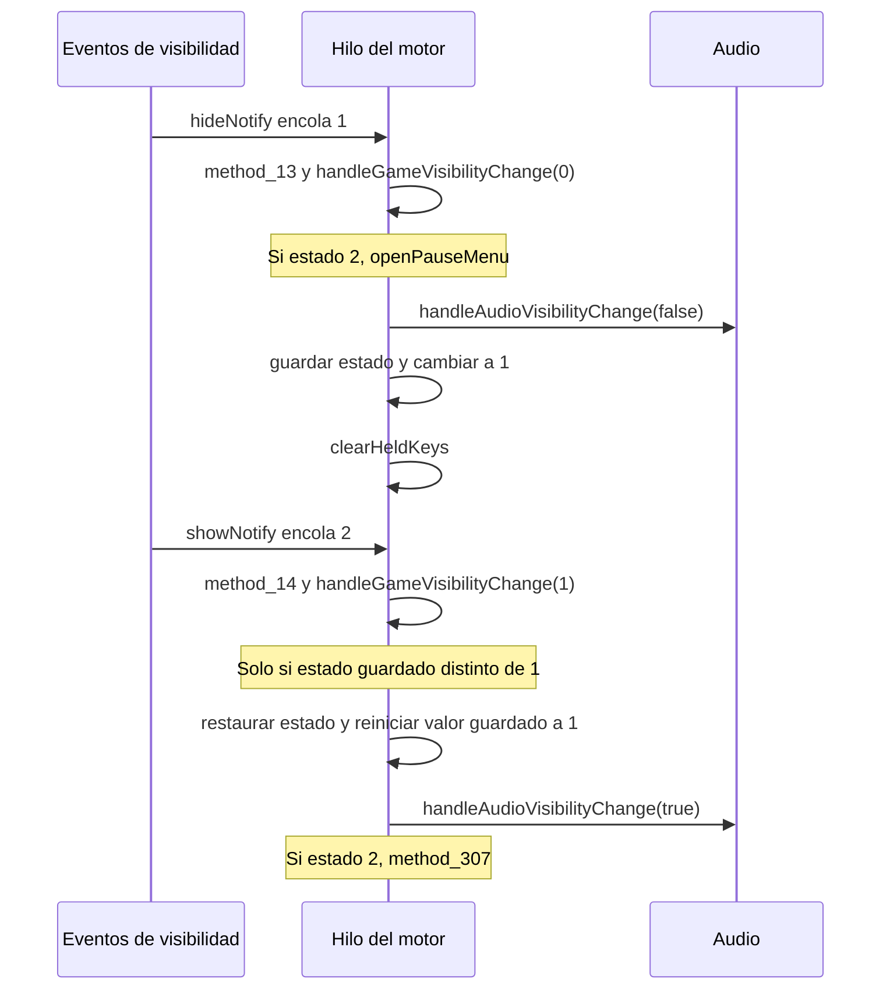

# Máquinas de estados y transiciones — DoctorHousePC

Documentación técnica de ingeniería inversa de House (2008), versión original 1.01, recuperado mediante Vineflower y adaptado a Java SE 17/21 en `PortDrHousePCByLoko`.

**Fecha de referencia:** 28 de noviembre de 2026.  
**Fuente principal:** `java(20261128-035013).zip`, `java/GameEngine.java` (8751 líneas).  
**Alcance:** tres primeras rondas de desofuscación, arquitectura recuperada, estados principales, subestados de introducción y menús, carga y transiciones observadas.  
**Verificación:** inspección estática del código y compilación de 15 archivos Java mediante JDK 21.0.12.1 con `--release 17` y `--release 21`. Ambos objetivos compilan; advertencias de operaciones genéricas no verificadas. No se realizaron pruebas de ejecución en esta revisión.

## 1. Objetivo y metodología

El propósito es comprender cómo se organizaba el videojuego original, no reemplazar su motor con un diseño moderno. La descompilación recupera instrucciones, pero no necesariamente los nombres originales. Los nombres semánticos actuales son reconstrucciones basadas en asignaciones, llamadas, condiciones y efectos del código recuperado.

Se distinguen tres niveles de evidencia:

- **Confirmado:** comportamiento directamente visible en declaraciones, ramas y asignaciones del fuente.
- **Interpretación:** significado de negocio o contexto deducido de las operaciones, sin verificar necesariamente textos o comportamiento en ejecución.
- **Pendiente:** responsabilidad específica que aún no se ha investigado lo suficiente para renombrar.

Se conservan los valores numéricos, los `switch`, los `return`, las transiciones implícitas entre casos y el formato de guardado. No se ha creado un `enum`, un framework de estados ni nuevas clases de estado. Los diagramas describen el motor existente; no son implementaciones propuestas.

## 2. Arquitectura general

```text
src/src/main/java/
├── Main.java
├── Mapp.java
├── GameEngine.java
├── configuration/GameConfiguration.java
└── javax/microedition/
    ├── lcdui/Display.java
    ├── lcdui/game/GameCanvas.java
    ├── media/Manager.java
    ├── media/Player.java
    ├── midlet/MIDlet.java
    └── rms/RecordStore.java
```

| Componente | Responsabilidad |
|---|---|
| `Main` / `Mapp` | Arranque y ciclo de vida de la aplicación. |
| `GameEngine` | Bucle principal, actualización, renderizado, máquinas de estados y coordinación de subsistemas. |
| `GameCanvas` / `Display` | Adaptación de entrada, ventana y renderizado de Java ME a escritorio. |
| `RecordStore` | Persistencia local del registro original de 512 bytes. |
| `Manager` / `Player` | Adaptación multimedia a Java Sound. |
| `GameConfiguration` | Configuración de resolución, ventana e idiomas. |



La jerarquía es conceptual: todos estos componentes siguen implementados principalmente mediante métodos y atributos estáticos de `GameEngine`, no como objetos independientes. Los estados de carga 8 y 9 pertenecen a la máquina principal; `loadingTaskId` no es otro estado principal.

## 3. Bucle de ejecución y despacho

### 3.1. Arranque

El constructor de `GameEngine` abre el almacenamiento (`method_80`), inicializa audio e idiomas, ejecuta `initializeGameState()` y arranca `field_29`, el hilo del motor. `initializeGameState()` asigna `currentGameState = 0`.

### 3.2. Ciclo principal

`run()` permanece activo mientras `field_30` sea verdadero. Consume primero los eventos de visibilidad de `field_48`. Existe una fase inicial controlada por `field_33`, con comprobación temporal de 2000 ms. Después ejecuta actualización y renderizado según las condiciones del motor.

- `method_15()` llama a `updateInputState()` y luego a `updateGameState()`.
- `method_16()` obtiene el contexto gráfico, establece el clip y llama a `renderGameState(field_40)`; evita reentrar si `field_40` no es nulo.
- `field_34` está inicializado a `true` en el fuente de referencia: la actualización se realiza desde `method_16()` cuando esa condición es verdadera. Si es falsa, `run()` llama a `method_15()` directamente.
- El intervalo mínimo normal es 62 ms; el delta registrado se limita superiormente a 186 ms. Estos valores no garantizan una frecuencia exacta de renderizado.
- Al terminar el bucle se invoca `Mapp.method_409()`; la limpieza del motor llama a `method_81()` y `shutdownAudio()` desde `method_17()`.

No se debe asumir que actualización y renderizado se ejecutan en hilos separados. Ambos pertenecen al hilo principal del motor, salvo el trabajo explícito del hilo de carga.

### 3.3. Despachadores

```java
public static final void updateGameState() {
    if (currentGameState != 1) {
        switch (currentGameState) {
            case 0: initializeGameEngine(); return;
            case 2: method_306(); return;
            case 3: updateSplashScreens(); return;
            case 4: updateIntroState(); return;
            case 5: updateMainMenuState(); return;
            case 6: method_298(); return;
            case 7: method_241(); return;
            case 8: startLoadingThread(); return;
            case 9: updateLoadingState();
            case 1:
        }
    }
}
```

```java
public static final void renderGameState(Graphics graphics) {
    field_228 = graphics;
    switch (currentGameState) {
        case 2: method_308(); break;
        case 3: renderSplashScreen(); break;
        case 4: renderIntroState(); break;
        case 5: renderMainMenuState(); break;
        case 6: method_299(); break;
        case 7: method_242(); break;
        case 8: renderLoadingScreen(); break;
        case 9: renderLoadingScreen();
    }
    field_228 = null;
}
```

Los fragmentos reproducen las operaciones del fuente con formato abreviado. `field_228` es el contexto gráfico temporal utilizado por los renderizadores. No hay rama de renderizado para 0 ni 1. El estado se consulta de nuevo en cada despacho: si la actualización cambia el estado, el renderizado posterior puede usar el nuevo valor.

## 4. Inventario de estados principales

| ID | Actualización | Renderizado | Responsabilidad |
|---:|---|---|---|
| 0 | `initializeGameEngine()` | — | Inicialización del motor y recursos básicos. |
| 1 | — | — | Suspensión de la aplicación. |
| 2 | `method_306()` | `method_308()` | Partida y modos internos, incluido menú de pausa. |
| 3 | `updateSplashScreens()` | `renderSplashScreen()` | Logotipos iniciales. |
| 4 | `updateIntroState()` | `renderIntroState()` | Introducción, idioma y audio. |
| 5 | `updateMainMenuState()` | `renderMainMenuState()` | Menú principal y sus subestados. |
| 6 | `method_298()` | `method_299()` | Pantalla de diálogo informativo; texto exacto pendiente. |
| 7 | `method_241()` | `method_242()` | Transición animada antes de cargar. |
| 8 | `startLoadingThread()` | `renderLoadingScreen()` | Preparación/lanzamiento del hilo de carga. |
| 9 | `updateLoadingState()` | `renderLoadingScreen()` | Espera a que termine el hilo de carga. |



La suspensión transversal se describe por separado porque puede conservar cualquiera de los estados principales. El diagrama no supone que todas las rutas de gameplay estén investigadas.

## 5. Tabla de transiciones principales observadas

| Origen | Destino | Método / condición | Efectos relevantes |
|---|---|---|---|
| Constructor | 0 | `initializeGameState()` | Establece el valor inicial. |
| 0 | 3 | `initializeGameEngine()` → `initializeSplashScreens()` | Inicializa dimensiones, preferencias, recursos y capacidad de volumen; carga primer logotipo. |
| 3 | 4 | `updateSplashScreens()` al agotar imágenes | Libera referencia de imagen anterior e inicializa introducción. |
| 4 | 5 | `updateIntroState()`, subestado 3, `field_238 <= 0` | `method_277()` → `enterMainMenu()`. |
| 5 | 6 | `method_297`, acciones 4/5 de `method_293` | Configura diálogo informativo. |
| 6 | 5 | `method_298`, respuesta >= 0 | Reconstruye menú informativo y restaura índice seleccionado. |
| 5 | 7 | `method_240`, acción de inicio/continuación o reinicio confirmado | Prepara desplazamientos y transición visual. |
| 7 | 8 | `method_241`, imagen desplazada y elementos en destino | `prepareLoading(0)`: detiene sonido y prepara pantalla de carga. |
| 8 | 9 | `startLoadingThread()` | Inicia hilo de prioridad 1. |
| 9 | 2 (destino normal) | `updateLoadingState()`, hilo terminado | Libera referencia del hilo, solicita música 1 y usa `gameStateAfterLoading`. |
| 2 | 5 | `method_342()` | Libera contexto de partida, reconstruye menú y reproduce música 0. |
| 2 | 5 | `method_343()` | Libera contexto, detiene audio, inicia transición y diálogo; `mainMenuState = 8`. |
| Estado actual | 1 | `handleGameVisibilityChange(0)` | Guarda estado, suspende audio y abre pausa si estaba jugando. |
| 1 / estado conservado | Estado guardado | `handleGameVisibilityChange(1)` si valor guardado != 1 | Restaura estado y audio; adapta contexto de gameplay. |
| 5, subestado 1 | Fin del bucle | Respuesta 0 | Detiene audio y asigna `field_30 = false`; no introduce otro estado numérico. |

## 6. Inicialización y logotipos (0 y 3)

`initializeGameEngine()` copia dimensiones del canvas, calcula centros, inicializa datos de guardado si `field_71[0] == -1`, recupera idioma guardado cuando existe y comprueba soporte de volumen con `supportsVolumeControl(3)`. Invoca `initializeSplashScreens()`.

El fuente de referencia contiene `splashImageIds = new int[]{28, 29}`. No se presupone que el logotipo FOX esté eliminado de esta versión. `currentSplashIndex` comienza en cero y `splashRemainingTicks` en 32. Cada actualización avanza por pulsación nueva o agotamiento del contador; el último logotipo conduce a `initializeIntro()`. El contador mide actualizaciones, no segundos exactos.

## 7. Submáquina de introducción (estado principal 4)

Atributo `introState` (antes `field_237`). Métodos `initializeIntro`, `updateIntroState` y `renderIntroState`.

| Subestado | Actualización | Renderizado |
|---:|---|---|
| 0 | Espera de 16 ticks iniciales o pulsación; avanza a 1. | `method_242()` |
| 1 | Comprueba idiomas disponibles y preferencia guardada; abre selector 4 o prepara diálogo de sonido 2. | `method_242()` |
| 2 | Respuesta 0: habilita audio, restablece 66 si guardado era 0, aplica volumen si soportado y reproduce pista 0. Respuesta 1: deshabilita y guarda 0. Ambas avanzan a 3. | `method_270()` |
| 3 | Reduce `field_238` hasta cero; pulsación nueva puede saltar la animación; al llegar a cero entra al menú. | `method_242()` |
| 4 | `method_261()` procesa navegación; acciones 32 + índice seleccionan idioma, cargan textos y abren diálogo de sonido. | `method_242()` y `method_262()` |



`initializeAudioEnablePrompt()` configura el diálogo mediante `method_265(25,26)`, `method_266(20,21)` y `method_267(...)`, y asigna `introState = 2`. No reproduce audio por sí mismo. El resultado se procesa en `updateIntroState()`.

`method_238()` construye las opciones de idioma. En estado principal 4 establece `introState = 4`; fuera de la introducción ajusta el menú existente. `method_293()` procesa la selección y decide si regresar al diálogo inicial o reconstruir el menú de ajustes.

## 8. Submáquina del menú principal (estado principal 5)

Atributo `mainMenuState`, antes `field_290`. `enterMainMenu()` llama a `method_283(0)` y establece el estado principal 5. No reinicia explícitamente `mainMenuState`; las rutas de retorno que lo necesitan lo asignan por separado.

| Subestado | Actualización | Renderizado |
|---:|---|---|
| 0 | `method_261()` procesa menú. | `renderIntroState()` y `method_262()`. |
| 1 | Respuesta 0: detener audio y bucle; 1: volver a 0. | Diálogo (`method_270`). |
| 2 | Respuesta 0: `field_71[4] = 0`, `method_240()`; 1: volver a 0. | Diálogo. |
| 3 | Asigna 2. | Fondo de introducción y diálogo por caída de caso. |
| 4 | Sin acción específica. | Sin acción específica. |
| 5 | Respuesta 0: detiene audio y retorna sin cambiar subestado; 1: asigna 0. | Diálogo. |
| 6 | Respuestas 0 y 1: asigna 0. | Diálogo. |
| 7 | Asigna 1. | Fondo de introducción y diálogo por caída de caso. |
| 8 | Si `method_328()` es verdadero, avanza transición mediante `method_329`; si no, asigna 9. | Dibuja imagen, diálogo y arco de transición. |
| 9 | Cualquier respuesta >= 0: `enterMainMenu()` y asigna 0. | Diálogo. |



Los estados 8 y 9 se alcanzan desde `method_343()` al retornar de gameplay, no necesariamente desde la navegación normal. Los estados 5 y 6 tienen inicializadores (`method_288` y `method_287`) y acciones 16/15 en el despachador. La ruta normal de construcción del menú ya no registra las antiguas opciones promocionales. No se ha demostrado que los estados sean completamente inalcanzables ni se ha confirmado el texto de sus diálogos; se conservan sin cambios. Los nombres `state5DialogResponse` y `state6DialogResponse` son deliberadamente provisionales.

### 8.1. Confirmaciones y caída de casos

`initializeExitConfirmation()` prepara el diálogo y asigna 7. `initializeRestartConfirmation()` prepara el diálogo y asigna 3. Sus variables `imageHeight` sirven para calcular la distribución vertical.

En `renderMainMenuState()` los casos 3 y 7 ejecutan `renderIntroState()` y caen al caso 5 para dibujar el diálogo. Añadir un `break` entre esos casos cambiaría la salida gráfica. No fusionar los subestados intermedios con sus sucesores sin pruebas.

### 8.2. Acciones del menú frente a estados

`method_293(int)` despacha un ID leído desde `field_257`, no un estado principal. Las acciones pueden reconstruir menús sin cambiar `mainMenuState`.

| Acción | Operación observada |
|---:|---|
| 0 | Comprueba guardado con `method_349()`; abre submenú de partida si existe, o inicia transición. |
| 1 | Inicia transición de carga. |
| 2 | Abre confirmación de reinicio. |
| 3 | Abre submenú informativo. |
| 4, 5 | Abren diálogos de estado principal 6. |
| 6 | Construye ajustes de audio del menú principal. |
| 7 | Abre confirmación de salida. |
| 8 | Reconstruye menú principal. |
| 9 | Cambia configuración de audio y refresca opción. |
| 10 | Desactiva pausa y restaura contexto de partida. |
| 11 | Construye ajustes de audio de pausa. |
| 12 | Llama a `method_344()`; inicia cadena de confirmaciones de salida de partida. |
| 13 | Reconstruye menú de pausa. |
| 14–16 | Ramas de menú/diálogo antiguas; accesibilidad pendiente. |
| 17 | Construye selector de idioma. |
| 32 + índice | Selecciona idioma; abre diálogo de sonido o ajustes según contexto. |

El reinicio confirmado modifica el byte 4 del buffer, no borra directamente el archivo físico. `method_349()` comprueba si ese byte vale 1; `loadGameplayResources()` consulta esa condición para recuperar los datos. La persistencia se analiza en `../savethegame.md`.

## 9. Submáquina del menú de pausa (dentro de gameplay)

`pauseMenuActive` selecciona el modo de pausa y `pauseMenuState` el subestado. `openPauseMenu()` solo inicializa si el menú no está activo: asigna el flag, llama a `method_333(0)` y establece subestado 0.

| Subestado | Actualización |
|---:|---|
| 0 | Navegación normal mediante `method_261()`. |
| 1 | Avanza a 2. |
| 2 | Respuesta 0: `method_345()` prepara siguiente confirmación (3); respuesta 1: vuelve a 0. |
| 3 | Avanza a 4. |
| 4 | Respuesta 0: `method_346()` guarda y `method_342()` regresa al menú principal; respuesta 1: regresa sin llamar al guardado en esa rama. |



`renderPauseMenuState()` dibuja el menú en 0 y el diálogo en 1–4. `method_308()` dibuja además el fondo de gameplay y `method_330()` durante la pausa, excepto en los subestados 2 y 4, donde omite esa rama y dibuja el diálogo.

La pausa se mantiene en `currentGameState = 2`. No equivale al estado principal 1. El código puede abrir el menú de pausa antes de suspender la aplicación; al restaurar el estado 2 no necesariamente se reanuda inmediatamente la partida normal.

`method_332()` vuelve de 4 a 3 o de 2 a 1 y asigna `field_276 = 15`, lo que permite reconstruir/redibujar el diálogo al recuperar visibilidad. Esta función sigue ofuscada.

## 10. Estado 6: diálogo informativo

`method_297(int var0, int var1)` reinicia elementos del menú, configura un rango de textos y un diálogo mediante `method_267(0, ..., 4)`, y establece `currentGameState = 6`. Las acciones 4 y 5 lo invocan con rangos (30,48) y (48,55).

`method_298()` espera una respuesta no negativa, conserva el índice devuelto por `method_264()`, reconstruye el menú mediante `method_285()`, restaura `field_261`, refresca mediante `method_259()` y vuelve a 5. `method_299()` dibuja el diálogo. El contenido literal de ambos textos no se ha verificado en esta revisión; no se asignan nombres de negocio definitivos.

## 11. Estado 7: transición animada hacia la carga

`method_240()` establece `field_244 = 0`, desplaza los objetivos `field_252` de los elementos del menú a la derecha de la pantalla y cambia el estado principal a 7.

`method_241()` llama a `method_249()`, comprueba que cada posición `field_247` coincida con su objetivo `field_252`, y desplaza `field_238` progresivamente hacia la izquierda, incrementando `field_244`. Solo llama a `prepareLoading(0)` cuando la imagen ha salido y todos los elementos han llegado a sus destinos.

`method_242()` rellena el fondo con color 65793 y dibuja `field_235` y `field_236`. Se reutiliza en la introducción; no es exclusivo del estado 7. Por ello no conviene asignarle un nombre que lo limite a la carga sin estudiar todos sus usos.



## 12. Carga asíncrona (estados 8 y 9)

| Identificador | Responsabilidad |
|---|---|
| `loadingTaskId` | ID de tarea solicitada. El hilo actual solo ejecuta trabajo para ID 0. |
| `gameStateAfterLoading` | Destino asignado por la carga; la ruta normal establece 2. |
| `loadingThread` | Referencia al hilo secundario. |
| `prepareLoading` | Detiene audio, guarda ID, prepara animación y cambia a 8. |
| `startLoadingThread` | Actualiza animación, cambia a 9, crea e inicia hilo. |
| `updateLoadingState` | Comprueba `isAlive()`, actualiza animación o cambia al destino. |
| `renderLoadingScreen` | Delega a `method_276()`. |
| `loadGameplayResources` | Carga datos, recursos y contexto de partida. |
| `yieldDuringLoading` | Si hay hilo vivo, llama a `Thread.yield()` en el hilo que ejecuta la llamada. |

```java
private static void prepareLoading(int loadingTaskId) {
    stopAudio();
    GameEngine.loadingTaskId = loadingTaskId;
    method_274(field_236.getHeight());
    currentGameState = 8;
}
```

La calificación `GameEngine.loadingTaskId` es indispensable con ese nombre de parámetro. Durante la desofuscación se corrigió una autoasignación accidental (`loadingTaskId = loadingTaskId`), que compilaba pero no actualizaba el atributo.

```java
private static void startLoadingThread() {
    method_275();
    currentGameState = 9;
    final int task = loadingTaskId;
    loadingThread = new Thread(() -> {
        if (task == 0) GameEngine.loadGameplayResources();
    });
    loadingThread.setPriority(1);
    loadingThread.start();
}
```



La pantalla de carga tiene su propia animación: `method_275()` incrementa `field_283`, reiniciándolo tras 24; `method_276()` dibuja una banda y segmentos de líneas desplazados. No es una barra de progreso basada en porcentaje de recursos cargados.

`isAlive()` informa si el hilo sigue ejecutándose, no si la carga tuvo éxito. No se ve un resultado explícito de éxito/error ni una política de recuperación de excepciones en este despachador. Una tarea no reconocida o un fallo de carga puede dejar un destino antiguo o no inicializado. Es un riesgo observado estáticamente, no un fallo reproducido. `Thread.yield()` tampoco garantiza un turno de ejecución ni sincronización. Estos aspectos deben evaluarse aparte de la desofuscación.

## 13. Suspensión y restauración (estado 1)



La cola `field_48` utiliza códigos 1 (ocultar) y 2 (mostrar), que no son los mismos códigos que recibe `handleGameVisibilityChange`: 0 indica ocultación y cualquier otro valor entra en la rama de restauración. Tampoco deben confundirse con los IDs de estados principales.

`gameStateBeforeSuspension` comienza en 1. Al ocultarse se guarda el estado actual y se cambia a 1. Al restaurarse se recupera el estado guardado únicamente si es distinto de 1, y se reinicia el valor guardado a 1. Una ocultación duplicada mientras ya está suspendido puede sobrescribir el estado anterior con 1; no existe una guarda explícita contra esa secuencia en el método. La suspensión no cancela ni pausa explícitamente `loadingThread`.

El adaptador `Display.java` de esta versión registra cierre y apertura de ventana, pero no enlaza minimización/restauración con `hideNotify()` y `showNotify()`. Por ello se ha identificado la lógica del motor, no demostrado el flujo completo de suspensión de escritorio. No introducir nuevos listeners como parte de un commit de renombramiento.

## 14. Gameplay: investigación parcial del estado 2

`method_306()` y `method_308()` son los despachadores lógico y gráfico del estado principal 2. Sus nombres aún no se han cambiado. La partida contiene varias modalidades controladas mediante flags, índices y condiciones; no todas son necesariamente máquinas de estados independientes.

| Condición o rama | Operación observada en actualización |
|---|---|
| `pauseMenuActive` | `updatePauseMenuState()` tiene prioridad. |
| Combinación de softkeys y contexto `field_347`, `field_348` | Puede abrir `openPauseMenu()`; no equivale a una tecla universal de pausa. |
| `method_328()` | Actualiza arco de transición con `method_329()`. |
| `field_378` | Consume un flag y puede solicitar eventos mediante `method_211()`. |
| `field_390` | Invoca `method_395()` antes de otras actualizaciones; contexto de minijuego. |
| Actualización común | Llama a `method_175()`, `method_392()` y `method_389()`. |
| `field_304 >= 0` | Delega en `method_324()`. |
| `field_341` | Delega en `method_355()`. |
| `field_347 >= 0` | Delega en `method_360()`; puede retornar anticipadamente. |
| `field_365 || field_366` | Delega en `method_370()`. |
| `field_390` o `field_407` | Delega en `method_396()` o `method_402()` respectivamente. |
| `field_299 > 0` | Delega en `method_309()`. |
| `method_188()` | Delega en `method_187()`, flujo de scripts. |
| Rama final | Comprueba música, estado de entidades/eventos y posible consumo de entrada mediante `method_352()`. |

Esta tabla es un resumen de ramas, no un reemplazo del método ni una descripción exhaustiva de sus condiciones booleanas. El orden y los retornos anticipados son importantes. No se deben convertir estos flags en un único enum sin comprobar exclusividad y combinaciones válidas.

`method_307()` adapta el contexto al recuperar visibilidad: llama a `method_332()` si está en pausa, a `method_357()` si `field_347 >= 0` y a `method_369()` en el contexto de `field_365 || field_366`. `method_308()` decide entre renderizado de mapa, minijuegos, diálogos y transición según los flags activos.

## 15. Relación con otros subsistemas

### Audio

- La inicialización comprueba `volumeControlSupported`; el subestado de introducción 2 procesa la decisión de activar sonido.
- `prepareLoading()` detiene la reproducción; `updateLoadingState()` solicita pista 1 al terminar la carga.
- El retorno normal al menú solicita pista 0; la ruta `method_343()` detiene audio.
- La suspensión delega en `handleAudioVisibilityChange`, que puede guardar y reiniciar una pista en bucle.
- La acción 9 de menú utiliza el sistema de configuración de audio ya desofuscado.

Véase [audioSystemGame.md](audioSystemGame.md). El control de volumen efectivo en `Player` permanece pendiente; no se ha incorporado soporte WAV en el código analizado.

### Entrada

`updateInputState()` consolida las máscaras de teclado antes de actualizar el estado. `hasNewKeyPress()` permite avanzar logotipos y animaciones. `method_269()` procesa navegación/selección de diálogos y retorna -1 si no hay respuesta definitiva, 0 o 1 según la selección en diálogos binarios. `method_261()` procesa navegación de menús. Las mismas teclas pueden tener efectos distintos dependiendo del estado; los IDs de máscaras de entrada no son IDs de menú ni de estado.

### Persistencia

`field_71` es el buffer RMS original. Índice 1: idioma; 3: volumen; 4: indicador de partida guardada según `method_349()`. `method_346()` escribe el indicador 1, datos adicionales y llama a `method_83()` para persistir. `method_347()` recupera datos; `method_348()` captura valores del contexto. No alterar índices ni eliminar guardados como parte de la desofuscación.

### Renderizado

`field_228` contiene el contexto gráfico asignado por `renderGameState()`. Algunos estados intermedios existen para dibujar fondos antes del diálogo; `field_276` interviene en las actualizaciones de partes de este. Las transiciones circulares usan `field_305` como incremento angular y `field_306` como ángulo: `method_328()` comprueba el intervalo abierto (0,360), `method_329()` actualiza y limita, y `method_330()` dibuja el arco. Estos identificadores permanecen ofuscados.

## 16. Inventario completo de renombramientos (40 identificadores)

Inventario acordado de las rondas 1–3. Incluye los dos nombres provisionales de respuestas de diálogos. No incluye el audio, los logotipos desofuscados anteriormente ni los identificadores todavía pendientes.

### 16.1. Atributos (9)

| Original | Actual | Función |
|---|---|---|
| `field_226` | `currentGameState` | Estado principal. |
| `field_227` | `gameStateBeforeSuspension` | Estado conservado durante suspensión. |
| `field_296` | `loadingTaskId` | Tarea de carga. |
| `field_297` | `gameStateAfterLoading` | Destino después de carga. |
| `field_298` | `loadingThread` | Hilo de carga. |
| `field_237` | `introState` | Subestado de introducción. |
| `field_290` | `mainMenuState` | Subestado del menú principal. |
| `field_321` | `pauseMenuActive` | Flag de pausa. |
| `field_322` | `pauseMenuState` | Subestado del menú de pausa. |

### 16.2. Métodos (22)

| Original | Actual |
|---|---|
| `method_222` | `initializeGameState` |
| `method_227` | `handleGameVisibilityChange` |
| `method_228` | `updateGameState` |
| `method_229` | `renderGameState` |
| `method_230` | `initializeGameEngine` |
| `method_234` | `initializeIntro` |
| `method_235` | `updateIntroState` |
| `method_239` | `renderIntroState` |
| `method_278` | `enterMainMenu` |
| `method_279` | `updateMainMenuState` |
| `method_280` | `renderMainMenuState` |
| `method_281` | `initializeExitConfirmation` |
| `method_282` | `initializeRestartConfirmation` |
| `method_300` | `yieldDuringLoading` |
| `method_301` | `prepareLoading` |
| `method_302` | `startLoadingThread` |
| `method_303` | `updateLoadingState` |
| `method_304` | `renderLoadingScreen` |
| `method_305` | `loadGameplayResources` |
| `method_331` | `openPauseMenu` |
| `method_339` | `updatePauseMenuState` |
| `method_340` | `renderPauseMenuState` |

### 16.3. Parámetros y variables locales (9)

| Método actual | Original | Actual |
|---|---|---|
| `handleGameVisibilityChange` | `var0` | `visibilityState` |
| `renderGameState` | `var0` | `graphics` |
| `prepareLoading` | `var0` | `loadingTaskId` |
| `initializeExitConfirmation` | `var0` | `imageHeight` |
| `initializeRestartConfirmation` | `var0` | `imageHeight` |
| `updateMainMenuState`, caso 1 | `var3` | `exitResponse` |
| `updateMainMenuState`, caso 2 | `var2` | `restartResponse` |
| `updateMainMenuState`, caso 5 | `var1` | `state5DialogResponse` |
| `updateMainMenuState`, caso 6 | `var0` | `state6DialogResponse` |

| Ronda | Atributos | Métodos | Locales | Total |
|---|---:|---:|---:|---:|
| 1: núcleo principal | 2 | 4 | 2 | 8 |
| 2: carga e introducción | 4 | 11 | 1 | 16 |
| 3: menú principal y pausa | 3 | 7 | 6 | 16 |
| **Total** | **9** | **22** | **9** | **40** |

Los parámetros pendientes de la primera ronda se completaron posteriormente pero se contabilizan una sola vez. El 100 % se refiere al inventario de 40 nombres, no a toda la arquitectura del juego.

## 17. Riesgos y límites de la investigación

| Observación estática | Acción futura |
|---|---|
| IDs de estados y acciones siguen siendo enteros literales. | Inventariar por dominio antes de extraer constantes. |
| `switch` con caída intencional. | Mantener la estructura durante renombramiento. |
| Ocultamiento de atributo por parámetro en `prepareLoading` (corregido). | Usar renombramiento semántico y revisar asignaciones. |
| El hilo terminado no equivale a carga exitosa. | Estudiar errores y destino; no modificar todavía. |
| Suspensión duplicada puede perder el estado conservado. | Validar secuencias de eventos antes de implementar una corrección. |
| La carga sigue su ejecución durante suspensión. | Probar ocultación y restauración durante carga. |
| Eventos de visibilidad de escritorio no enlazados. | Probar y diseñar puente de ciclo de vida separado. |
| Estados promocionales antiguos conservados. | Investigar accesibilidad antes de eliminar. |
| Textos de diálogos no verificados literalmente. | Contrastar recursos en inglés y español. |
| Muchas ramas de gameplay aún ofuscadas. | Investigar subestados y modos, sin asumir exclusividad. |

## 18. Plan de regresión

Estas pruebas están propuestas, no ejecutadas durante esta actualización documental. Usar una copia de `House.sav` o un directorio aislado mediante `-Dhouse.saveDir=...` para evitar modificar una partida real.

| ID | Caso | Resultado esperado según el fuente |
|---|---|---|
| E01 | Arranque nuevo sin guardado | 0 → 3 → 4; idioma cuando corresponde; diálogo de audio. |
| E02 | Avanzar logotipos por tecla o tiempo | Pasa al siguiente logotipo o a introducción. |
| E03 | Elegir idioma | Subestado 4 → 2; preferencia actualizada. |
| E04 | Aceptar o rechazar sonido | 2 → 3; política de audio coherente. |
| E05 | Terminar o saltar animación inicial | Estado principal 4 → 5. |
| E06 | Abrir información y cerrar | 5 → 6 → 5; selección restaurada. |
| E07 | Salir del juego y cancelar | Subestado 0 → 7 → 1 → 0; bucle activo. |
| E08 | Confirmar salida | Audio detenido y bucle finalizado. |
| E09 | Iniciar partida sin guardado | 5 → 7 → 8 → 9 → 2 en carga normal. |
| E10 | Continuar partida guardada | Carga consulta el indicador y recupera datos. |
| E11 | Confirmar reinicio | Byte 4 pasa a 0; inicia transición a nueva partida. |
| E12 | Cancelar reinicio | Subestado 2 → 0; no invalida guardado. |
| E13 | Abrir pausa y reanudar | Estado principal 2 permanece; cambia `pauseMenuActive`. |
| E14 | Cancelar salida desde pausa | Subestado 2 → 0. |
| E15 | Salir de partida guardando | Subestado 4, respuesta 0; escritura y retorno al menú. |
| E16 | Salir de partida sin guardar | Subestado 4, respuesta 1; retorno sin escritura en esa rama. |
| E17 | Ruta de retorno `method_343` | Estado 5, subestados 8 → 9 → 0. |
| E18 | Suspender y restaurar mediante eventos del motor | Guarda/restaura estado y audio; probar casos duplicados. |
| E19 | Suspender durante carga | Comprobar terminación del hilo y destino al restaurar. |
| E20 | Provocar fallo de carga en entorno aislado | Registrar comportamiento real; no asumir recuperación automática. |
| E21 | Comparar Java 17 y 21 en ejecución | Validar navegación, carga, audio y guardado en ambos runtimes. |

Para registrar transiciones, preferir un commit temporal de diagnóstico o un debugger con puntos de interrupción sobre las asignaciones. No imprimir cada frame de manera permanente ni alterar temporización como parte de la desofuscación.

## 19. Próximas rondas

1. Investigar `method_240–242`, `method_297–299` y `method_306–308`; considerar todos los usos compartidos antes de proponer nombres.
2. Identificar helpers de transición circular y animación de carga (`method_274–276`, `method_326–330`) y sus atributos.
3. Completar las variables locales de introducción y pausa, incluyendo respuestas de diálogos cuando se verifiquen sus significados.
4. Investigar modos de gameplay, scripts, diálogos y minijuegos por separado.
5. Extraer constantes semánticas de cada dominio sin cambiar valores. Evaluar un enum únicamente tras entender todas las transiciones y consumidores.
6. Validar comportamiento con pruebas de regresión antes de modularizar el motor o ampliar la capa de compatibilidad.

## 20. Referencias verificables

Las líneas siguientes corresponden exclusivamente a `java(20261128-035013).zip` y pueden desplazarse en nuevas versiones.

| Archivo / líneas | Contenido |
|---|---|
| `GameEngine.java`, 520–539 | Atributos de máquinas de estados y catálogo de logotipos. |
| 908–1046 | Constructor, eventos, bucle, actualización, renderizado y limpieza. |
| 5014–5016 | Inicialización de estado principal. |
| 5096–5178 | Suspensión y despachadores principales. |
| 5180–5231 | Inicialización y logotipos. |
| 5233–5370 | Introducción y subestados. |
| 5372–5407 | Transición animada y fondo compartido. |
| 5777–5816 | Procesamiento de respuestas de diálogo. |
| 5895–5954 | Pantalla de carga y delegación al menú. |
| 5956–6085 | Entrada al menú, actualización, renderizado y confirmaciones. |
| 6088–6284 | Constructores y acciones del menú. |
| 6340–6362 | Estado principal 6. |
| 6364–6518 | Carga asíncrona. |
| 6521–6649 | Actualización, restauración y renderizado de gameplay. |
| 6956–6988 | Transición circular. |
| 6992–7009 | Apertura de pausa y restauración de diálogo. |
| 7118–7166 | Actualización y renderizado de pausa. |
| 7168–7253 | Retorno al menú, confirmaciones y persistencia. |
| `java/javax/microedition/lcdui/Display.java` | Eventos de ventana implementados en el port. |
| [audioSystemGame.md](audioSystemGame.md) | Investigación del sistema de audio. |
| [savethegame.md](../savethegame.md) | Investigación de persistencia. |

**Conclusión:** las tres primeras rondas han hecho explícito el núcleo de la arquitectura de estados que ya existía en el motor. Quedan transiciones, modos internos y dependencias por estudiar. El código Java no fue modificado para elaborar este documento; la compilación no sustituye la validación funcional del videojuego.
