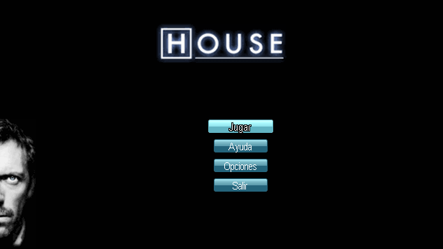
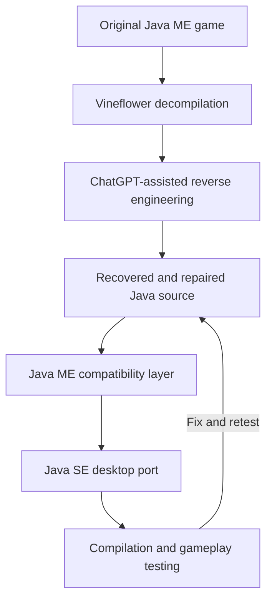

<h1 align="center">FelipedelosH</h1>
<br>
<h4>PortDrHousePCByLoko</h4>



<p align="center">
  
  
  
</p>

:construction: **Under Development** :construction:

**PortDrHousePCByLoko** is a personal project dedicated to bringing the original 2008 *House* mobile game back to life on modern computers.

Driven by my love for *House M.D.*, nostalgia for classic Java mobile games, and my passion for software engineering, this project explores how reverse engineering and artificial intelligence can work together to preserve a piece of video game history.

Using Vineflower and ChatGPT, I have brought the original Java ME game engine to Java SE, allowing it to run on a desktop without a mobile emulator. The goal is to preserve its original graphics, gameplay, story, and atmosphere as faithfully as possible.

## :heart: The Story Behind This Project

Many years ago, I used to play the House mobile game on my phone. As a fan of *House M.D.*, it was a special way to experience the world of a series I love. I wanted to revisit that experience on a modern computer rather than leave it behind on an old mobile platform.

Years later, with my interest in software development and artificial intelligence, I decided to turn that nostalgia into a personal engineering challenge: could I bring the original game back to life on a PC?

This project is my attempt to answer that question. It is a tribute to House, classic mobile gaming, and the curiosity that makes us want to understand how software works.

## :video_game: The Original Game

| Property | Details |
| :--- | :--- |
| Title | House |
| Version | 1.01 |
| Year | 2008 |
| Developer (manifest) | mobiground.com |
| Platform | Java ME (J2ME) |
| Declared configuration | CLDC 1.0 |
| Declared profile | MIDP 1.0 |
| Main class | `Mapp` |
| Languages | English and Spanish |

## :robot: Reverse Engineering with AI

This is not a remake built from scratch. The project uses the recovered game engine and original resources, adapting the mobile APIs to desktop Java.

The development process combined conventional reverse engineering with AI-assisted analysis and implementation:

1. **Preservation:** retain the original JAR and inspect its bytecode, manifest, and resources.
2. **Decompilation:** use Vineflower 1.12.0 to recover Java source from the original compiled classes.
3. **AI-assisted investigation:** use ChatGPT to analyze obfuscated classes, identify responsibilities, trace execution flows, and examine resource formats.
4. **Source recovery:** repair invalid decompiled constructs, reconstruct auxiliary structures, and resolve broken class references.
5. **Desktop migration:** implement a Java ME compatibility layer using Swing, Java2D, Java MIDI, and local file storage.
6. **Incremental testing:** compile the recovered engine, launch it, exercise menus and input, and correct problems revealed during execution.



One example of a problem found during testing was a rendering freeze caused by decompiled loops using `byte` counters. Replacing the affected counters with `int` prevented overflow beyond 127. The original engine's normal 62 ms loop interval was retained to avoid unnecessary changes to gameplay timing.

AI helped accelerate investigation, implementation, and debugging. Compilation and runtime tests were used to validate the results. The recovered source is not claimed to be identical to the original developer's source code.

## :hammer: Features

- `Desktop execution`: run the recovered game engine using Java SE, without a J2ME emulator.
- `Original assets`: retain the original sprites, graphics, binary resources, and dialogue data.
- `Language support`: preserve the original English and Spanish language selection.
- `Keyboard controls`: map the original mobile keypad and softkeys to PC keys.
- `Desktop rendering`: display the game using Swing and Java2D with pixel-art scaling.
- `MIDI audio`: provide a Java MIDI playback adapter; audible playback still needs validation.
- `Local saves`: provide a file-based replacement for Java ME RecordStore; saving and resuming still need end-to-end testing.

## :camera: Screenshots

The initial desktop port has rendered the original hospital, characters, and Spanish dialogue in runtime tests.

<!-- Add the real runtime screenshot at Docs/screenshot.png to enable the following image:

-->

## :play_or_pause_button: How to Run

### Requirements

- Windows with PowerShell.
- JDK 17 or JDK 21 (including `java` and `javac`).
- The project source and original runtime resources in `src/main/`.

Open a terminal in the project root and verify your installation:

```
cd src
```

```powershell
java -version
javac -version
```

### Java 17

```powershell
powershell -ExecutionPolicy Bypass -File .\run-java17.ps1
```

### Java 21

```powershell
powershell -ExecutionPolicy Bypass -File .\run-java21.ps1
```

Both scripts compile the source and launch the game directly. Gradle is not required for this method.

If you have multiple JDKs installed, configure the appropriate installation paths before launching (adjust these examples to your actual directories):

```powershell
$env:JAVA_HOME_17 = "C:\Program Files\Java\jdk-17"
$env:JAVA_HOME_21 = "C:\Program Files\Java\jdk-21"
```

The scripts use separate output directories under `build/`. Keep the original resource paths in `src/main/resources/` unchanged.

## :keyboard: Controls

| PC key | Action |
| :--- | :--- |
| Arrow keys or 2/4/6/8 | Movement and navigation |
| Enter, Space or 5 | Select and interact |
| F1 | Left mobile softkey |
| F2 or Escape | Right mobile softkey |
| 0–9 | Original numeric keypad |
| * and # | Special keypad keys |

If the keyboard does not respond, click inside the game window to restore focus.

## :hammer_and_wrench: Technologies

| Technology | Purpose |
| :--- | :--- |
| Java SE 17 / 21 | Desktop application and game engine |
| Swing / Java2D | Window management and rendering |
| Java Sound / MIDI | Audio playback |
| Java NIO / local files | Persistence |
| Gradle | Build configuration |
| Visual Studio Code | Development environment |
| Vineflower 1.12.0 | Java decompilation |
| ChatGPT | AI-assisted reverse engineering and development |
| PowerShell | Windows compilation and launch scripts |
| Git / GitHub | Version control and project hosting |

## :world_map: Roadmap

- [x] Preserve and inspect the original game.
- [x] Decompile the Java ME engine with Vineflower.
- [x] Recover source structures and implement the initial compatibility layer.
- [x] Compile with Java 21 and verify Java 17 compilation compatibility.
- [x] Launch the game, navigate the menu, and start a new game in initial runtime tests.
- [ ] Validate execution on Windows with both JDK versions.
- [ ] Complete gameplay, movement, dialogue, and minigame testing.
- [ ] Validate MIDI playback, volume control, and save/load behavior.
- [ ] Compare the port against the original game in an emulator.
- [ ] Improve desktop usability, configurable controls, and packaging.

## :books: Documentation

The main project structure separates original materials, reverse-engineering references, and the desktop implementation:

```text
PortDrHousePCByLoko/
├── Docs/                  # Project documentation and images
├── INPUT/                 # Original game JAR
├── TOOLS/                 # Reverse-engineering tools
├── DECOMPILED/            # Unmodified decompiler output (reference copy)
├── src/
│   ├── main/
│   │   ├── java/          # Recovered engine and compatibility layer
│   │   └── resources/     # Runtime game assets
│   └── test/              # Planned automated tests
├── build.gradle
├── settings.gradle
├── run-java17.ps1
├── run-java21.ps1
└── README.md
```

See the [Docs directory](Docs/) for technical documentation and reverse-engineering notes. The detailed technical README should be kept separately from this main project introduction.

## :warning: Disclaimer

This project is an experimental, unofficial fan port for personal learning, reverse engineering, and software preservation. It is not affiliated with the original game developer or the owners of *House M.D.*

Version 0.1.0 is not a finished game. Initial runtime tests were conducted using Java 21 on Linux with a virtual display. Java 17 source compatibility was checked through compilation, but execution on a real JDK 17 and Windows still needs validation. Full gameplay, audio, persistence, and graphical fidelity remain to be tested. Legacy SMS and promotional link functionality has been disabled.

All rights to the original game, characters, trademarks, and assets belong to their respective owners. No ownership or license over the original copyrighted materials is claimed. Any public distribution of the original game or its resources is subject to the applicable permissions and rights.

## :technologist: Author

| [<br><sub>Andrés Felipe Hernánez</sub>](https://github.com/felipedelosh) |
| :---: |

---

<p align="center">Made with nostalgia, curiosity, software engineering, and artificial intelligence.</p>
