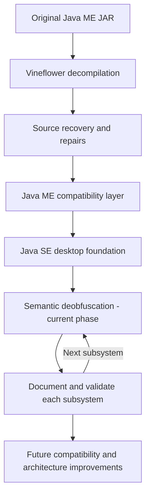
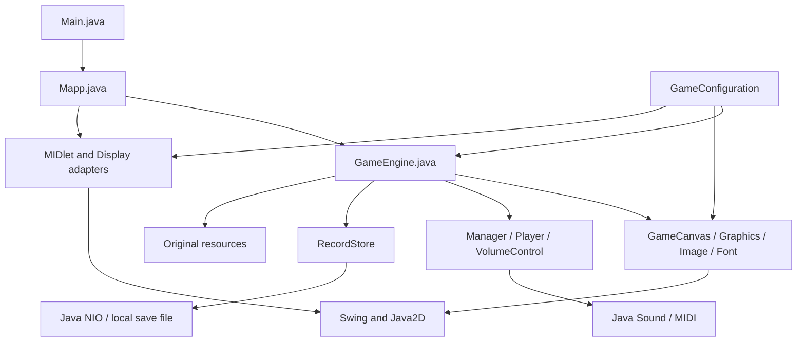

<h1 align="center">FelipedelosH</h1>
<h2 align="center">PortDrHousePCByLoko</h2>


<p align="center">
  
  
  
</p>

:construction: **Current phase: reverse engineering and semantic deobfuscation** :construction:

**PortDrHousePCByLoko** is a personal software preservation project dedicated to bringing the original 2008 *House* mobile game to modern computers and understanding how its developers designed and implemented it.

The initial migration from Java ME to Java SE has established a playable desktop foundation without a mobile emulator. The main objective now is to recover the meaning of the obfuscated code, document its architecture, and progressively make the original engine understandable and maintainable.

This is not a remake. The project retains the recovered engine and original resources. New features and architectural redesigns are secondary to understanding and preserving the original behavior.

## :heart: The Story Behind This Project

Many years ago, I used to play the House mobile game on my phone. As a fan of *House M.D.*, it was a special way to experience the world of a series I love. Years later, my interest in software engineering and artificial intelligence turned that nostalgia into a personal engineering challenge: could I bring the original game back to life on a PC and understand how it worked internally?

This project is a tribute to House, classic mobile gaming, and the curiosity that drives us to understand software.

## :video_game: The Original Game

| Property | Details |
| :--- | :--- |
| Title | House |
| Original version | 1.01 |
| Year | 2008 |
| Developer (original manifest) | mobiground.com |
| Platform | Java ME (J2ME) |
| Declared configuration | CLDC 1.0 |
| Declared profile | MIDP 1.0 |
| Original MIDlet class | `Mapp` |
| Languages | English and Spanish |

## :robot: Reverse Engineering with AI

Vineflower 1.12.0 was used to decompile the original Java bytecode. ChatGPT assists with source analysis, tracing dependencies, proposing semantic names, documenting findings, and investigating compatibility issues. The recovered source is not claimed to be identical to the original developers' source code.



During initial source recovery, a rendering freeze was traced to decompiled loops using `byte` counters. The affected counters were replaced with `int` to prevent overflow. The original engine's normal 62 ms loop interval was retained to avoid unnecessary changes to gameplay timing.

## :mag: Current Phase: Semantic Deobfuscation

Decompilation recovered executable Java source, but many identifiers remain obfuscated, such as `field_71`, `method_294`, and local variables such as `var0`. Compilable code is not necessarily understandable code.

The current task is to reconstruct the meaning of these identifiers from their declarations, assignments, call sites, control flow, resource usage, and observable behavior. Names are written in English and are descriptive of the responsibilities supported by the evidence.

### Working principles

1. Understand the original implementation before proposing changes.
2. Trace all references and dependencies of an identifier before renaming it.
3. Rename identifiers in small, coherent groups, using semantic rename tools where possible.
4. Preserve algorithms, signatures, state transitions, resource identifiers, and save-data layouts during rename-only commits.
5. Compile and perform targeted regression tests after each group of changes.
6. Document confirmed findings and distinguish them from hypotheses.
7. Restore missing Java ME compatibility features before introducing desktop-specific alternatives.

Functional fixes and new features should be isolated from semantic refactoring so they can be reviewed and tested separately. Uncertain names remain unchanged until more evidence is available.

### Example: audio system

| Original identifier | Current semantic identifier |
| :--- | :--- |
| `field_63` | `audioResourcePaths` |
| `field_65` | `audioEnabled` |
| `field_66` | `audioVolume` |
| `field_67` | `currentAudioId` |
| `field_69` | `audioPlayer` |
| `field_229` | `volumeControlSupported` |
| `method_69` | `playAudio` |
| `method_70` | `stopAudio` |
| `method_75` | `setAudioVolume` |
| `method_224` | `changeAudioSetting` |
| `method_225` | `toggleAudio` |
| `method_226` | `cycleAudioVolume` |

The original engine already includes audio activation, volume cycling (0, 33, 66, 100), persistent settings, and menu synchronization. The current Java SE `Player.getControl()` implementation returns `null`, so the original volume-control capability is not yet exposed by the adapter. The engine consequently uses its original sound-toggle fallback. Earlier experimental F5/F6 changes were reverted to prioritize the original architecture.

See [audioSystemGame.md](Docs/originalDevDoc/audioSystemGame.md) for the detailed investigation.

## :building_construction: Repository Structure

The repository root contains the preservation materials and documentation. The **desktop Gradle module is located in the outer `src/` directory**, and its Java source set is inside a second, nested `src/` directory.

```text
PortDrHousePCByLoko/
├── Docs/                         # Documentation and images
│   ├── banner.png
│   ├── audioSystemGame.md
│   └── savethegame.md
├── INPUT/                        # Original game materials
├── TOOLS/                        # Reverse-engineering tools
├── DECOMPILED/                   # Decompiler output for reference
├── src/                          # Desktop Java SE module
│   ├── .gradle/                  # Generated Gradle cache (local)
│   ├── build/                    # Generated compilation output (local)
│   ├── src/
│   │   └── main/
│   │       ├── java/
│   │       │   ├── Main.java
│   │       │   ├── Mapp.java
│   │       │   ├── GameEngine.java
│   │       │   ├── SpriteData.java
│   │       │   ├── configuration/
│   │       │   │   └── GameConfiguration.java
│   │       │   └── javax/
│   │       │       └── microedition/
│   │       │           ├── lcdui/
│   │       │           │   ├── Display.java
│   │       │           │   ├── Font.java
│   │       │           │   ├── Graphics.java
│   │       │           │   ├── Image.java
│   │       │           │   └── game/
│   │       │           │       └── GameCanvas.java
│   │       │           ├── media/
│   │       │           │   ├── Manager.java
│   │       │           │   ├── Player.java
│   │       │           │   └── control/
│   │       │           │       └── VolumeControl.java
│   │       │           ├── midlet/
│   │       │           │   └── MIDlet.java
│   │       │           └── rms/
│   │       │               └── RecordStore.java
│   │       └── resources/        # Original runtime assets
│   ├── build.gradle
│   ├── settings.gradle
│   ├── README.md                 # Module documentation
│   ├── README_PORT.md            # Port documentation
│   ├── run-java17.ps1
│   └── run-java21.ps1
└── README.md                     # Repository overview (this file)
```

The tree shows the relevant implementation and documentation, not an exhaustive listing of every resource or generated file. `.gradle/` and `build/` are local generated directories, not source code.

### Runtime architecture



| Component | Responsibility |
| :--- | :--- |
| `Main.java` | Desktop entry point. |
| `Mapp.java` | Recovered MIDlet application and lifecycle bridge. |
| `GameEngine.java` | Recovered game engine, including input, state dispatch, rendering, audio, maps, scripts, and minigames. Previously named `class_3`. |
| `SpriteData.java` | Recovered auxiliary sprite data structure. |
| `GameConfiguration.java` | Desktop resolution, window scaling, fullscreen option, and language configuration. |
| `javax.microedition.*` | Compatibility adapters for the Java ME APIs used by the game. These are not a complete Java ME implementation. |
| `resources/` | Original graphics, text, audio, and binary game data. |

The recovered engine remains largely monolithic. A future modular architecture is a goal, not a description of the current implementation.

## :hammer: Current Desktop Foundation

- Desktop execution through Java SE without a J2ME emulator.
- Original sprites, dialogue, and other runtime assets retained.
- English and Spanish language selection.
- Original mobile input mapped to PC keyboard controls.
- Swing/Java2D rendering with configurable resolution and window scaling.
- Java MIDI playback adapter; original multi-level volume support remains pending.
- File-based RecordStore replacement; full save/load regression coverage remains pending.
- Legacy promotional/SMS functionality removed from the recovered implementation.
- Language configuration moved out of the original MIDlet manifest into `GameConfiguration`.

## :play_or_pause_button: How to Run

### Requirements

- Windows with PowerShell.
- JDK 17 or JDK 21, including `java` and `javac`.
- Recovered sources and required runtime resources in the desktop module.

From the **repository root**, enter the desktop module:

```powershell
cd src
java -version
javac -version
```

### Java 17

```powershell
powershell -ExecutionPolicy Bypass -File .\run-java17.ps1
```

### Java 21

```powershell
powershell -ExecutionPolicy Bypass -File .\run-java21.ps1
```

If multiple JDKs are installed, specify their installation directories (adjust these examples to your machine):

```powershell
$env:JAVA_HOME_17 = "C:\Program Files\Java\jdk-17"
$env:JAVA_HOME_21 = "C:\Program Files\Java\jdk-21"
```

The scripts compile using `javac`, launch `Main`, and include the runtime resource directory in the classpath. Gradle is not required when using these scripts. Compilation output is stored in `src/build/classes-java17/` or `src/build/classes-java21/`, relative to the repository root.

| Location | Repository-relative path |
| :--- | :--- |
| Desktop module | `src/` |
| Java sources | `src/src/main/java/` |
| Runtime resources | `src/src/main/resources/` |
| Desktop configuration | `src/src/main/java/configuration/GameConfiguration.java` |

### Display configuration

The current configuration defaults to `Resolution.TV_SD` (640 × 480), `WINDOW_SCALE = 1`, and `FULLSCREEN = false`. Available resolution presets include ORIGINAL (240 × 320), QVGA (320 × 240), TV_SD (640 × 480), HD (1280 × 720), and FULL_HD (1920 × 1080). Not every screen or minigame has been verified at every resolution.

### Local saves

The default save path is `%USERPROFILE%\.doctorhousepc\House.sav` on a typical Windows Java installation. The adapter uses Java's `user.home` property, and the directory can be overridden through the JVM property `house.saveDir`.

## :keyboard: Controls

| PC key | Original game action |
| :--- | :--- |
| Arrow keys or 2/4/6/8 | Movement and navigation |
| Enter, Space or 5 | Select and interact |
| F1 | Left mobile softkey |
| F2 or Escape | Right mobile softkey |
| 0–9 | Original numeric keypad |
| * and # | Special keypad keys |

If the keyboard does not respond, click inside the game window to restore focus. F5/F6 volume shortcuts are not part of the current implementation.

## :camera: Screenshots

Initial desktop runtime tests have rendered the original hospital, characters, and Spanish dialogue.

<!-- Add a verified runtime screenshot here when available in the repository:

-->

## :world_map: Roadmap

### Phase 1 — Preservation and initial desktop port

- [x] Preserve and inspect the original game.
- [x] Decompile the Java ME engine with Vineflower.
- [x] Recover source structures and implement the initial compatibility layer.
- [x] Establish compilation compatibility with Java 17 and 21.
- [x] Launch the desktop game and perform initial gameplay tests.

### Phase 2 — Semantic deobfuscation (current)

- [x] Rename the main recovered engine to `GameEngine`.
- [x] Investigate and rename the core keyboard input identifiers.
- [x] Investigate and rename splash screen identifiers.
- [x] Investigate and rename language configuration identifiers.
- [x] Rename the core audio playback identifiers.
- [x] Rename original audio setting methods and audio menu item identifiers.
- [ ] Finish audio menu methods and document remaining dependencies.
- [ ] Deobfuscate persistence and save-data indices.
- [ ] Deobfuscate binary and image resource loading.
- [ ] Investigate the game loop, lifecycle, and state machine.
- [ ] Investigate menu construction and navigation.
- [ ] Investigate rendering, sprites, maps, and collision detection.
- [ ] Investigate character movement and animation.
- [ ] Investigate dialogue, events, and the script engine.
- [ ] Investigate minigames and remaining gameplay systems.
- [ ] Rename local variables and parameters as their meaning becomes clear.

Progress is tracked by investigated identifiers and subsystems rather than by an unverified percentage of project completion. Completing a rename batch does not imply that all behavior of the subsystem is fully understood or tested.

### Phase 3 — Compatibility, regression testing, and future improvements

- [ ] Restore the original multi-level volume control through the Java ME compatibility layer.
- [ ] Validate save/load behavior and complete gameplay on supported JDKs.
- [ ] Compare behavior and rendering against the original game.
- [ ] Evaluate desktop usability improvements after the relevant original subsystems are understood.
- [ ] Evaluate modularization and packaging without unnecessary changes to original gameplay.

## :books: Documentation

Technical notes are maintained in [Docs/](Docs/). The detailed module and port documentation are located in the outer `src/` directory.

| Document | Purpose |
| :--- | :--- |
| [Audio system](Docs/audioSystemGame.md) | Original audio architecture, semantic identifiers, volume behavior, persistence, and adapter limitations. |
| [Save system](Docs/savethegame.md) | File-based RecordStore and save location. |
| [Module README](src/README.md) | Desktop module technical documentation. |
| [Port README](src/README_PORT.md) | Desktop port notes. |

Documentation should be updated alongside validated findings. Older documents may contain historical names or paths that precede recent refactoring.

## :hammer_and_wrench: Technologies

| Technology | Purpose |
| :--- | :--- |
| Java SE 17 / 21 | Desktop application and recovered game engine |
| Swing / Java2D | Window management and rendering |
| Java Sound / MIDI | Audio playback |
| Java NIO | Local persistence |
| Gradle | Build configuration |
| PowerShell | Windows compilation and launch scripts |
| Vineflower 1.12.0 | Java bytecode decompilation |
| ChatGPT | AI-assisted reverse engineering and documentation |
| Visual Studio Code | Development and semantic renaming |
| Git / GitHub | Incremental version control and project hosting |

## :warning: Disclaimer

This project is an experimental, unofficial fan port for personal learning, reverse engineering, and software preservation. It is not affiliated with the original game developer or the owners of *House M.D.*

The desktop port is a work in progress, not a finished release. Full gameplay, graphical fidelity, audio compatibility, and persistence still require comprehensive regression testing. Semantic names are reconstructed interpretations, not necessarily the original developers' names.

All rights to the original game, characters, trademarks, and assets belong to their respective owners. No ownership or license over the original copyrighted materials is claimed. Any public distribution of the original game or its resources is subject to applicable permissions and rights.

## :technologist: Author

| [<br><sub>Andrés Felipe Hernánez</sub>](https://github.com/felipedelosh) |
| :---: |

---

<p align="center">Made with nostalgia, curiosity, software engineering, and artificial intelligence.</p>
